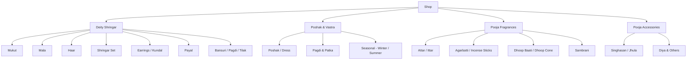
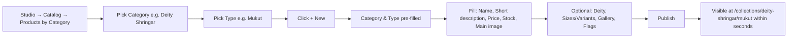
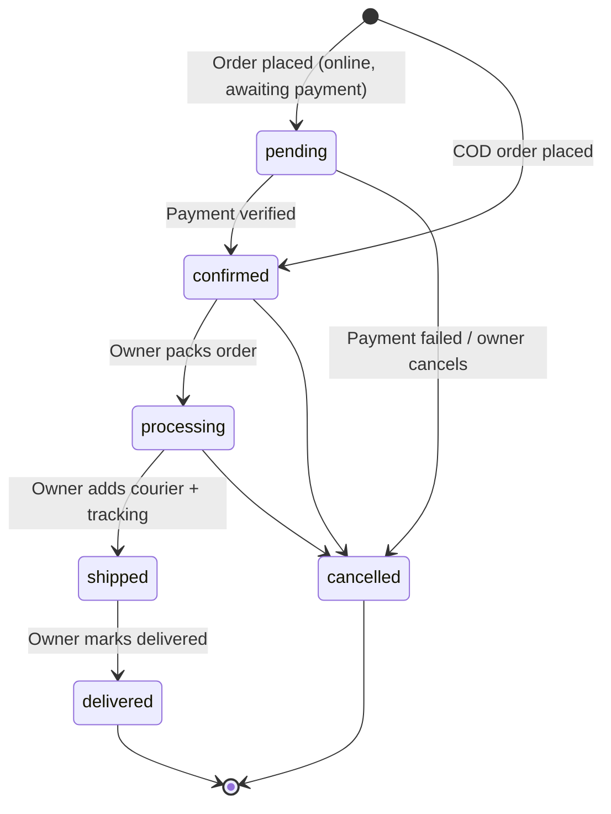
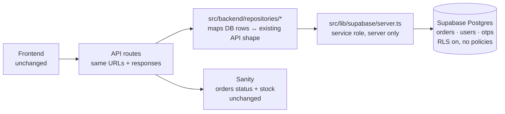

# PRD — Catalog Structure, Sanity CMS Management & Feedback Moderation

| Item | Value |
|---|---|
| Product | Nikunj Sakhi — Divine God Ornaments & Pooja Essentials |
| Version | 1.0 (draft) |
| Date | 2026-10-04 |
| Scope | Storefront navigation and category browsing, Sanity Studio product management, feedback/review moderation |
| Previous PRD | None found in the repo (`docs/`, `.gsd/`, `audit/` contain only templates or are empty). The [README](../README.md) is the only earlier spec. This document replaces it as the source of truth for the catalog and CMS. |

---

## 1. Problem Statement

1. **Customers can't find products.** The main navigation only links to sections on the homepage. There's no "Shop" entry, no category menu, and no way to browse by product type (Mukut, Mala, Attar, Agarbatti, and so on).
2. **Products aren't grouped.** Categories and Product Types are separate, unrelated lists. The site can't show a hierarchy like Myntra or Flipkart (for example, *Shringar → Mukut*).
3. **The store owner can't manage the catalog in Sanity.** The product form has duplicate legacy fields and too many required fields. Nothing shows where a product will appear on the site. Hero Slides, Testimonials, and Coupons exist in the schema but are **hidden from the Studio menu**.
4. **The feedback form is a placeholder.** Submissions aren't saved anywhere, the reviews next to the form are hardcoded, and the owner can't control what's visible.

---

## 2. Audit Findings (current code)

| # | Area | Finding | Evidence |
|---|---|---|---|
| A1 | Navigation | Nav links are homepage anchors only (`/#collections`, `/#products`…). No `/products` link and no category menu. | [Navbar.tsx](../src/frontend/components/layout/Navbar.tsx#L18-L24) |
| A2 | Routing | `src/app/collections/[collection]/` is an **empty folder**, so the route isn't implemented. | `src/app/collections/[collection]/` |
| A3 | Routing | All browsing goes through query strings (`/products?category=…`). There are no clean, SEO-friendly category or type URLs. | [products/page.tsx](../src/app/products/page.tsx) |
| A4 | Taxonomy | `productType` has no link to `category`, so the filter sidebar shows every type (Attar next to Mukut) no matter which category is selected. | [productType.ts](../src/cms/schemas/productType.ts) |
| A5 | Taxonomy | `productType` has no `isActive`, `image`, or `showInMenu` fields, so it can't drive menus or tiles. | [productType.ts](../src/cms/schemas/productType.ts) |
| A6 | Sorting bug | `price_desc` sorts **ascending** because the whole `select()` is ordered `asc`. | [queries.ts](../src/cms/lib/queries.ts#L196-L204) |
| A7 | Filter bug | The price filter and sort use `price` and ignore `salePrice`. The default sort uses `sortOrder` and ignores legacy `displayOrder`. | [queries.ts](../src/cms/lib/queries.ts#L190-L204) |
| A8 | Search | Search only matches `name` and `deity`. It doesn't match type, category, or fragrance (for example, a search for "payal" or "attar" can miss products). | [queries.ts](../src/cms/lib/queries.ts#L190) |
| A9 | Studio | The custom desk structure leaves out **Hero Slides, Testimonials, and Coupons**, so they can't be reached from the menu. | [deskStructure.ts](../src/cms/deskStructure.ts) |
| A10 | Studio | Products are one flat list with no grouping by category or type, no "Out of stock" view, and no "Hidden" view. | [deskStructure.ts](../src/cms/deskStructure.ts) |
| A11 | Studio | Duplicate legacy fields (`price/originalPrice/salePrice`, `stock/stockQuantity`, `images/galleryImages/mainImage`, `sortOrder/displayOrder`) make the form confusing. | [product.ts](../src/cms/schemas/product.ts) |
| A12 | Studio | Too many required fields slow down uploads: `longDescription`, `galleryImages` (min 1), and `sku`. | [product.ts](../src/cms/schemas/product.ts) |
| A13 | Studio | The same form is used for ornaments and fragrances. Attar needs volume (3/6/12 ml), Agarbatti needs pack size, and ornaments need deity size (Laddu Gopal 0–6). | [product.ts](../src/cms/schemas/product.ts) |
| A14 | Feedback | `onSubmit` only waits 1 second and doesn't save anything. Reviews are hardcoded in `sampleReviews`. | [FeedbackForm.tsx](../src/frontend/components/home/FeedbackForm.tsx#L22-L66) |
| A15 | Feedback | There's no Sanity type for submitted feedback and no toggle to show or hide the section. | [schemas/index.ts](../src/cms/schemas/index.ts) |
| A16 | Deployment | The hosted Studio (`sanity.io/@…/studio/…/nikunj-sakhi`) runs the **last deployed** schema. Code changes don't appear there until `npx sanity deploy` runs. The embedded `/studio` always uses the current code. | [sanity.config.ts](../sanity.config.ts) |
| A17 | Breadcrumb | The breadcrumb on the product detail page says "Collections" but links to `/products` and doesn't include the category or type. | [products/[slug]/page.tsx](../src/app/products/[slug]/page.tsx#L145) |

---

## 3. Goals & Non-Goals

### Goals
- G1: Every active product can be reached in **≤ 3 clicks** from any page (menu → category → type → product).
- G2: Two-level catalog (**Category → Product Type**), plus cross-cutting filters (Deity, Size, Fragrance, Material, Price, Colour), similar to Myntra or Flipkart.
- G3: The owner can add a product in Sanity in **under 3 minutes** without technical help and can see where it will appear.
- G4: All website content (products, banners, reviews, coupons, feedback) can be managed from one organized Studio menu.
- G5: Feedback is stored, moderated (Pending → Approved/Rejected), and only approved items are shown publicly.

### Non-Goals
- Multi-vendor support, inventory sync with an external ERP, or moving off Sanity or MongoDB.
- Redesigning the visual design system.

---

## 4. Target Catalog Taxonomy

The owner edits these in Sanity; the values below are the starting seed data.



**Facets used as filters, not as menu levels:**

| Facet | Applies to | Examples |
|---|---|---|
| Deity | Shringar, Vastra | Laddu Gopal, Radha Krishna, Shiv Parivar, Durga Maa, Hanuman Ji |
| Deity Size | Shringar, Vastra | Laddu Gopal 0, 1, 2, 3, 4, 5, 6 · Murti height in inches |
| Fragrance | Pooja Fragrances | Rose, Mogra, Chandan, Kewda, Khus, Oudh |
| Volume / Pack | Pooja Fragrances | 3 ml, 6 ml, 12 ml · 20 sticks, 100 g, 12 cones |
| Material | Shringar | Brass, Pearl, Kundan, Stone, Zari |
| Colour | Shringar, Vastra | Red, Yellow, Green… |
| Price | All | Under ₹500, ₹500–999, ₹1000–2499, ₹2500+ |
| Flags | All | Featured, Best Seller, New Arrival, Premium |

---

## 5. Requirements

### 5.1 Storefront — Navigation & Routing

| ID | Requirement | Priority |
|---|---|---|
| R1 | Add a **"Shop"** mega-menu to the Navbar, built from Sanity. It lists each active category (by `displayOrder`) with its active product types underneath. On mobile it's an accordion. | P0 |
| R2 | Add a **"Shop All"** link to `/collections`. | P0 |
| R3 | Implement clean routes: `/collections` (all), `/collections/[category]`, and `/collections/[category]/[type]`. Filters (deity, size, fragrance, price, sort, page) stay as query params. | P0 |
| R4 | Keep backward compatibility: `/products?category=x&productType=y` permanently redirects (308) to the matching clean route. `/products/[slug]` (product detail) is unchanged. | P0 |
| R5 | A category landing page shows a row of **type tiles** (image and name) above the product grid, like Myntra's sub-category chips. | P1 |
| R6 | The filter sidebar is **context-aware**: it only shows types for the current category, and only shows facets that apply (no Fragrance filter on Mukut, no Deity Size filter on Attar). | P0 |
| R7 | Show the product count next to each type and filter value. Hide values with a count of 0. | P2 |
| R8 | Breadcrumbs: `Home › Category › Type › Product` on the product page, plus `BreadcrumbList` JSON-LD. | P1 |
| R9 | Update the sitemap to include all category and type routes. | P1 |
| R10 | Footer gets a "Shop by Category" column, generated from Sanity. | P2 |
| R11 | The homepage `CategoryGrid` links to `/collections/[category]`. | P0 |

### 5.2 Storefront — Search, Sort & Filter Fixes

| ID | Requirement | Priority |
|---|---|---|
| R12 | Fix the sort: `price_desc` must be descending. Sort on the effective price `coalesce(salePrice, price)`. | P0 |
| R13 | The price filter uses the effective price. | P0 |
| R14 | The default order is `coalesce(sortOrder, displayOrder, 0)`, then `_createdAt desc`. | P0 |
| R15 | Search matches name, deity, product type, category, fragrance, and SKU, with prefix match (`$q*`). | P1 |
| R16 | The page `<title>` and `<h1>` use the category or type **name** instead of the slug. | P1 |

### 5.3 Sanity — Schema Changes

| ID | Requirement | Priority |
|---|---|---|
| S1 | **`productType`**: add `category` (reference, required), `image`, `isActive`, `showInMenu`, and `appliesFacets` (multi-select: deity, size, fragrance, volume, material, colour). This makes it a sub-category. | P0 |
| S2 | **`product`**: `productType` becomes **required**. Its picker is filtered to the selected `category` (`options.filter: 'category._ref == $cat'`). A validation rule rejects a type that doesn't belong to the product's category. | P0 |
| S3 | **`product`**: show fields based on the type's facets: `fragrance` and `volumeOptions` only for fragrance types, and `deity` and `sizes` only for Shringar or Vastra types. | P1 |
| S4 | **`product`**: make `longDescription`, `galleryImages`, and `sku` optional. Auto-suggest the SKU from the type prefix and slug (for example `MUK-radha-krishna-red`). | P0 |
| S5 | **`product`**: hide legacy fields (`originalPrice`, `stock`, `images`, `displayOrder`) using `hidden: ({value}) => value === undefined`, and add a one-time migration script that copies values into the new fields. | P1 |
| S6 | **`product`**: add a `variants[]` object (label, price, salePrice, stock, sku). This replaces `sizes[].priceModifier` and covers Laddu Gopal size, Attar ml, and Agarbatti pack. | P1 |
| S7 | **`product`** preview shows `Category › Type · ₹price · stock`, with clear ✅/❌/⚠️ indicators for active, hidden, or out of stock. | P0 |
| S8 | **`category`**: add `showInMenu` and `bannerImage` (for the landing page header). | P1 |
| S9 | **`siteSettings`**: add home section toggles: `showFeedbackForm`, `showReviews`, `showInstagram`, `showWhyUs`. | P0 |
| S10 | Validation: slugs must be unique within their type, and a product needs at least one image (`mainImage` or a gallery image). | P0 |

### 5.4 Sanity — Studio Menu (Desk Structure)

```
Nikunj Sakhi CMS
├── 🛍️ Catalog
│   ├── All Products
│   ├── Products by Category      → Category → Type → products (create here pre-fills category + type)
│   ├── ⚠️ Out of Stock
│   ├── ❌ Hidden / Inactive
│   ├── ⭐ Featured / Best Sellers / New Arrivals
│   ├── Categories                 (ordered by displayOrder)
│   ├── Product Types              (grouped by Category)
│   ├── Deities
│   └── Fragrances
├── 🏠 Homepage
│   ├── Hero Slides                (currently unreachable — A9)
│   └── Section Visibility         (siteSettings toggles, S9)
├── 💬 Reviews & Feedback
│   ├── 🕒 Pending Approval
│   ├── ✅ Shown on Website
│   ├── 🚫 Rejected / Hidden
│   └── All
├── 🏷️ Coupons                     (currently unreachable — A9)
├── 📦 Sales
│   ├── Orders
│   └── Customers
└── ⚙️ Site Settings
```

| ID | Requirement | Priority |
|---|---|---|
| D1 | Implement the structure above in `deskStructure.ts`. | P0 |
| D2 | Add **initial value templates** (`product-by-type`) so that clicking "+" inside *Shringar → Mukut* pre-fills `category` and `productType`. | P0 |
| D3 | Add **document actions** on Feedback: "Approve & Show" and "Reject". | P1 |
| D4 | Add a **Preview / View on site** link on products that opens `/products/[slug]`. | P2 |
| D5 | Run `npx sanity deploy` after every schema change so the hosted Studio stays in sync with `/studio` (A16). Add an `npm run studio:deploy` script. | P0 |

### 5.5 Feedback / Reviews

Use **one document type** so the owner has a single place to manage reviews. Extend the existing `testimonial` type into **"Review & Feedback"**. This avoids two overlapping lists.

| ID | Requirement | Priority |
|---|---|---|
| F1 | Add these fields to the schema: `source` (`website-form` / `manual`), `status` (`pending` / `approved` / `rejected`, default `pending`), `phone` (**private**: never returned in public GROQ), `productName` (free text from the form), `submittedAt`, and `showOnHomepage` (boolean). Keep the existing `isActive` as "Show on Website". | P0 |
| F2 | New API route `POST /api/feedback`: zod validation (same rules as the form), honeypot field, per-IP rate limit (for example 3 per 10 minutes), and HTML/whitespace sanitization. It writes to Sanity with the server-only write token, `status = pending` and `isActive = false`. | P0 |
| F3 | `FeedbackForm` calls `/api/feedback` and handles errors. Remove the hardcoded `sampleReviews` and show approved reviews from Sanity next to the form. | P0 |
| F4 | Public queries filter `status == "approved" && isActive == true` and never select `phone`. | P0 |
| F5 | The home page only renders the feedback form and review sections when the `siteSettings` toggles allow it (S9). | P0 |
| F6 | Optional: an approved review linked to a product appears on that product's detail page, along with its average rating. | P2 |

**Security notes:** `SANITY_API_TOKEN` is used only in route handlers and never with a `NEXT_PUBLIC_` prefix. Validate input on the server, cap lengths, store the phone number but never expose it, and enforce the rate limit to prevent spam.

---

## 6. Owner Workflow — "How do I add a product?"



Required fields when publishing a new product: **Name, Category, Type, Price, Stock, Main Image, Short Description**. Everything else is optional.

---

## 7. Data Migration

| Step | Action |
|---|---|
| M1 | Create the seed categories and types from Section 4 if they're missing (extend [scripts/seed.mjs](../scripts/seed.mjs)). |
| M2 | For each existing `productType`, set `category` by mapping its name (for example Mukut/Mala/Haar → Deity Shringar; Attar/Agarbatti/Dhoop → Pooja Fragrances). |
| M3 | For each product without a `productType`, list it in a report for the owner to assign manually. Products remain visible in the "All" view until assigned. |
| M4 | Copy legacy → new fields: `images[0] → mainImage`, `images[1..] → galleryImages`, `stock → stockQuantity`, `displayOrder → sortOrder`, `originalPrice` → (`price`, with `salePrice` set to the old `price`). |
| M5 | Back up first: `npx sanity dataset export production backup-YYYYMMDD.tar.gz`. |

---

## 8. Delivery Plan

| Phase | Scope | Requirements | Exit criteria |
|---|---|---|---|
| **P1 — Quick fixes** | Sort/filter bugs, Studio menu shows all types, Shop link | R2, R11, R12–R14, D1 (partial: add Hero, Testimonials, Coupons), D5 | Price high-to-low sorts correctly; Hero, Reviews, and Coupons are editable in the Studio |
| **P2 — Taxonomy** | `productType.category`, product type filter, seed and migration | S1, S2, S4, S7, S10, M1–M5 | Every product has a category and type; the type picker is filtered by category |
| **P3 — Storefront IA** | `/collections` routes, mega-menu, context-aware filters, breadcrumbs, redirects, sitemap | R1, R3–R6, R8, R9, R16 | Every product can be reached in ≤ 3 clicks; old URLs redirect |
| **P4 — Studio UX** | Grouped desk, templates, conditional fields, variants, legacy hiding | D1–D2, S3, S5, S6, S8 | The owner adds a Mukut and an Attar in under 3 minutes each without help |
| **P5 — Feedback** | Schema, API, moderation views, visibility toggles | F1–F5, S9, D3 | A submitted review appears as Pending and shows on the site only after approval |
| **P6 — Polish** | Search, counts, footer, product reviews, preview link | R7, R10, R15, F6, D4 | Searches for "payal" and "attar" return the right products |

---

## 9. Acceptance Criteria

- [ ] The Navbar shows **Shop** with every active category and type. Clicking *Mukut* opens `/collections/deity-shringar/mukut` and lists only mukuts.
- [ ] Filters on the Attar page show Fragrance and Volume but not Deity Size. Filters on the Mukut page show Deity and Size but not Fragrance.
- [ ] Sorting by Price: High → Low returns products in descending effective price.
- [ ] `/products?category=deity-shringar` redirects to `/collections/deity-shringar`.
- [ ] In the Studio, *Catalog → Products by Category → Pooja Fragrances → Attar → +* opens a new product with category and type already set.
- [ ] Hero Slides, Reviews & Feedback, and Coupons are visible in the Studio menu, both in the hosted Studio and in `/studio`.
- [ ] A product can't be published without Name, Category, Type, Price, Stock, Main Image, and Short Description, and can be published with only those.
- [ ] Submitting the feedback form creates a **Pending** document in Sanity. It doesn't appear on the site until it's approved.
- [ ] Turning off `showFeedbackForm` in Site Settings hides the section on the homepage.
- [ ] Public API responses never include a reviewer's phone number.
- [ ] `npm run build` passes with no type errors.

---

## 10. Open Questions

1. Confirm the top-level categories in Section 4. Should **Poshak / Vastra** be its own category or a type under Shringar?
2. Should Deity be a menu level ("Shop by Deity → Laddu Gopal") as well as a filter? Recommendation: add a separate **"Shop by Deity"** menu column using the existing `deity` documents.
3. Should reviews collect a photo upload? (This adds image handling to the API and needs moderation.)
4. Is the hosted Studio (sanity.io) or the embedded `/studio` the main admin URL? Both work, but the hosted one needs `sanity deploy` after each change.

---

## 11. Phase 7 — Cart Details, Order Tracking, Reviews Layout & Visual Updates

**Status:** Phases 1–6 are done. This section was added on 2026-10-05 and covers the next round of owner requests.

### 11.1 Audit findings

| # | Area | Finding | Evidence |
|---|---|---|---|
| B1 | Cart | Cart items are **not clickable**. The image and name don't link to the product, and there's no way to change the chosen option. | [checkout/page.tsx](../src/app/checkout/page.tsx#L225-L272) |
| B2 | Cart | Size and colour only appear if one was picked. Items added from product cards or the quick-view popup can skip the choice, and the cart doesn't show the unit price, category or type. | [checkout/page.tsx](../src/app/checkout/page.tsx#L248-L253) |
| B3 | Orders | **Orders exist in two places that never sync.** Real orders are saved in MongoDB. The Studio "Orders" list is a separate, empty Sanity type. Changing a status in Studio does nothing for the customer. | [Order.ts](../src/backend/models/Order.ts), [schemas/order.ts](../src/cms/schemas/order.ts) |
| B4 | Orders | The status can only be changed through an admin API (`PATCH /api/orders/[id]`), and there's no screen for it. There's no tracking number, no status history and no customer notification. | [orders/[id]/route.ts](../src/app/api/orders/%5Bid%5D/route.ts) |
| B5 | Orders | Stock is checked when an order is placed but **never reduced**, so the same stock can be sold more than once. | [orders/route.ts](../src/app/api/orders/route.ts#L121-L142) |
| B6 | Orders | Customers can see their order list on `/account`, but there's no order detail or tracking page, and guests have no way to track an order. | [account/page.tsx](../src/app/account/page.tsx#L112-L134) |
| B7 | Reviews | The homepage has two overlapping sections: **"Divine Testimonials"** and **"Leave a Review"** (the feedback form plus 2 reviews). | [TestimonialsSection.tsx](../src/frontend/components/home/TestimonialsSection.tsx), [FeedbackForm.tsx](../src/frontend/components/home/FeedbackForm.tsx) |
| B8 | Login | The brand is typed text ("Nikunj Sakhi"), not the logo, and the background is a plain cream colour. | [login/page.tsx](../src/app/login/page.tsx#L72-L80) |
| B9 | Promise | "The Nikunj Sakhi Promise" is a centred 3×2 grid of cards with no image. | [WhyUs.tsx](../src/frontend/components/home/WhyUs.tsx) |
| B10 | Assets | The uploaded files `public/Login BG.jpg` and `public/The Nikunj Sakhi Promise.jpg` have spaces in their names, which is fragile in URLs. | `public/` |

### 11.2 Requirements

#### A. Cart: clickable, complete and editable

| ID | Requirement | Priority |
|---|---|---|
| C1 | The cart item **image and name link to the product page** (`/products/[slug]`), in both the checkout cart and the cart sidebar. | P0 |
| C2 | Each item shows everything chosen: **category › type, deity, option/size, colour, unit price, quantity and line total**. Missing choices show "Standard" instead of being hidden. | P0 |
| C3 | **Edit the choice inside the cart:** when a product has options or colours, show accessible dropdowns (`<select>` with labels) on the cart item. Changing one updates the price and merges with an identical existing line. Requires saving the available options with each cart item when it's added. | P0 |
| C4 | Products that have options can't be added from a product card or quick view without one. The button opens the quick view instead of adding a default option silently. | P1 |
| C5 | Accessibility: keyboard focus styles, `aria-label`s on the quantity and remove buttons (already present), price changes announced with `aria-live`, and touch targets of at least 44 px. | P0 |
| C6 | The server still recalculates price and stock at checkout (already in place). The cart is never trusted for prices. | P0 |

#### B. Orders: end-to-end status that the customer can see

**Recommended approach: one source of truth in MongoDB, plus a simple owner dashboard at `/admin/orders`.**

Order data contains customer names, phone numbers and addresses. The Sanity dataset is **publicly readable**, so storing orders there would expose personal data. MongoDB already holds every order, so the plan adds a simple screen on top of it.

| ID | Requirement | Priority |
|---|---|---|
| O1 | **Owner login:** the owner signs in with the existing OTP login. Their phone number is set as `admin` (one-time script, or an `ADMIN_PHONES` environment variable). `/admin` pages and admin APIs require `role === 'admin'` on the server. | P0 |
| O2 | **`/admin/orders` dashboard** (works on mobile): tabs for **New · Processing · Shipped · Delivered · Cancelled** with counts, search by order ID, name or phone, and newest first. | P0 |
| O3 | **Order detail (admin):** items with their options, address with a copy button, payment status, and **one-tap status buttons** (Confirm → Processing → Shipped → Delivered, plus Cancel). Shipping asks for **courier name and tracking number/URL**. | P0 |
| O4 | **Status history:** every change is stored as `statusHistory[] {status, at, note}` and shown to both the owner and the customer as a timeline. | P0 |
| O5 | **Customer order page** `/account/orders/[orderId]` with a timeline (Placed → Confirmed → Processing → Shipped → Delivered), tracking link, items, address and totals. The `/account` order list links to it. | P0 |
| O6 | **Guest tracking** at `/track-order`: the customer enters order ID + phone number and sees the same timeline. Rate-limited, and only shows data when both match. | P1 |
| O7 | **Notify the customer:** after each status change, the dashboard shows a **"Send WhatsApp update"** button that opens WhatsApp with a ready-made message (order ID, new status, tracking link). Free, no API needed, and fits a one-person shop. Automatic SMS or email can be added later. | P0 |
| O8 | **Notify the owner of new orders:** the dashboard header shows a badge with the number of new orders. Optional: a WhatsApp or email alert. | P1 |
| O9 | **Stock:** when an order is confirmed (COD placed, or online payment verified), reduce `stockQuantity` (and the chosen option's stock) in Sanity. When it's cancelled, add the stock back. This needs an **Editor** Sanity token. | P0 |
| O10 | **Clean up Studio:** remove the unused Sanity `order` and `customer` types from the Studio menu and replace them with a **"📦 Manage Orders ↗"** link to `/admin/orders`, so there's only one place to manage orders. The schemas stay registered so no data is lost. | P0 |
| O11 | Cancelling a paid order flags it **"Refund due"** for the owner to refund in Razorpay. Automatic refunds are out of scope. | P1 |

**Status flow**



Only forward moves (and Cancel) are allowed. Every change is recorded in `statusHistory` and shown to the customer immediately (pages are dynamic, not cached).

#### C. Reviews: one "Devotee Feedback" section, split into two parts

| ID | Requirement | Priority |
|---|---|---|
| R1 | **Remove** the "Divine Testimonials" section from the homepage. | P0 |
| R2 | Add a single section with the heading **"Devotee Feedback"** and the subtitle *"Thousands of satisfied devotees across India"*. | P0 |
| R3 | The section has **two parts**: **(1) Visible Feedback**, showing all approved reviews (cards with stars, name, location and product, with "Show more" after 6); **(2) Share Your Feedback**, the form. Side by side on desktop, stacked on mobile. | P0 |
| R4 | Navigation: **Reviews** goes to the visible feedback part and **Contact** goes to the form. Both keep the Phase 6 scroll fix. | P0 |
| R5 | With no approved reviews yet, the visible part shows "Be the first to share your experience", and the form is still shown. | P0 |
| R6 | The `showReviews` and `showFeedbackForm` switches in Site Settings still control each part separately. | P1 |

#### D. Login page

| ID | Requirement | Priority |
|---|---|---|
| L1 | Replace the typed "Nikunj Sakhi" with the **logo image** (`next/image`, alt text "Nikunj Sakhi – Divine God Ornaments"). | P0 |
| L2 | Use the uploaded **Login BG** image as a full-page background (`object-cover`, centred), with a light cream overlay so the form stays readable. The login card gets a slightly see-through white background. | P0 |
| L3 | Rename the file to `public/login-bg.jpg` (no spaces) and serve it through `next/image` with compression. | P0 |

#### E. "The Nikunj Sakhi Promise" layout

| ID | Requirement | Priority |
|---|---|---|
| P1 | Two columns on desktop: the **image on the left** (`The Nikunj Sakhi Promise.jpg`, renamed to `promise.jpg`) and the **heading plus 6 promise blocks on the right** in a 2×3 grid. | P0 |
| P2 | Blend the image into the theme: its white background disappears into the cream page using `mix-blend-multiply`, a soft gold glow behind it, and no hard border. | P0 |
| P3 | On mobile, show the image on top (smaller) and the blocks below in one column. Keep the existing animations, which respect reduced-motion settings. | P0 |

### 11.3 Data model changes (MongoDB `Order`)

```ts
statusHistory: [{ status: string, at: Date, note?: string }]   // new
tracking: { courier?: string, number?: string, url?: string }  // new
stockAdjusted: boolean                                        // new; prevents double stock changes
```

Existing orders get a single-entry `statusHistory` built from their current `status` and `createdAt`.

### 11.4 Delivery plan

| Step | Scope | IDs | Exit criteria |
|---|---|---|---|
| 7.1 | Reviews section + Promise layout + Login page | R1–R6, P1–P3, L1–L3 | Visual check on desktop and mobile; "Divine Testimonials" is gone |
| 7.2 | Cart details and option editing | C1–C6 | Clicking a cart item opens the product; changing an option updates the price; checkout still verifies on the server |
| 7.3 | Order model, admin dashboard, customer tracking | O1–O8, O10–O11 | The owner changes status → the customer's order page shows the new status and tracking immediately |
| 7.4 | Stock reduction and return | O9 | Placing/cancelling an order changes Sanity stock exactly once (needs the Editor token) |

### 11.5 Acceptance criteria

- [ ] In the checkout cart, clicking an item's image or name opens its product page. Option, colour, unit price and line total are always visible.
- [ ] Changing an item's option in the cart updates the line price, and checkout charges the server-verified amount.
- [ ] The owner logs in → `/admin/orders` → marks an order **Shipped** with tracking → the customer's `/account/orders/[id]` shows "Shipped" plus the tracking link on reload.
- [ ] A guest can track an order at `/track-order` with order ID + phone, and gets nothing with a wrong phone number.
- [ ] Non-admin users get 403 from all `/api/admin/*` routes, and `/admin` redirects them to login.
- [ ] The homepage has no "Divine Testimonials" section. "Devotee Feedback" shows approved reviews and the form as two parts.
- [ ] The login page shows the logo and the Login BG background, and the text passes 4.5:1 contrast.
- [ ] The Promise section shows the image on the left and the blocks on the right on desktop, and stacks on mobile.
- [ ] `npx tsc --noEmit` passes, and all pages return 200.

### 11.6 Decisions (confirmed by owner, 2026-10-05) — supersedes the open questions

1. **Orders are managed in Sanity Studio** (📦 Orders). They are stored under the private ID path `orders.<orderId>`. We tested that anonymous API requests cannot read them, so customer data stays private even though the dataset is public. Orders open in Studio as soon as they are created (no publish step). Status changes only through the **Mark as …**, **Cancel Order** and **Send WhatsApp update** buttons, so the status history stays complete.
2. **Admin phone numbers** are managed in Studio → 🔐 Admin Access (private document `settings.admin`). It holds the order WhatsApp number and the admin mobile numbers that get the admin role when they log in with OTP.
3. **Notifications use free WhatsApp click-to-chat:** after ordering, the customer sends their order details to the shop's WhatsApp number in one tap. The owner sends each status update from Studio in one tap. Fully automatic messages need the paid WhatsApp Business API (out of scope).
4. **Stock reduction is included:** stock goes down when an order is confirmed (in the same transaction that creates the order) and is restored when the order is cancelled in Studio.
5. **Customers track orders** at `/track-order` with order ID + phone, or are signed in automatically from My Orders.

**Status: implemented.** Requires a Sanity **Editor** token and a reachable MongoDB in production. Existing orders can be copied into Sanity with `scripts/sync-orders-to-sanity.mjs`.

### 11.7 Previous open questions (resolved above)

1. **Order management location.** Is it OK to manage orders at **`/admin/orders`** on the website (recommended: private, simple, works on a phone) rather than inside Sanity Studio? Studio will get a link to it.
2. **Owner phone number(s)** that should get admin access.
3. **Customer notifications.** Is the free "Send WhatsApp update" button enough for now, or do you want automatic SMS through MSG91 (costs per SMS and needs a DLT-approved template)?
4. **Stock reduction (O9)** needs the Sanity **Editor** token in `.env.local`. Should it be included in this phase?

---

## 12. Phase 8: Move the Database from MongoDB to Supabase (PostgreSQL)

**Status:** Analysis and plan only. **No code has been changed.** Implementation starts after the decisions in §12.9 are confirmed.
**Brief:** the owner's migration brief ("MongoDB → Supabase Migration", 18 sections), dated 2026-10-05.
**Principle:** change **only the data layer**. URLs, request and response shapes, login, admin roles, prices, stock, Sanity syncing and the UI stay the same.

### 12.1 Audit: everything that uses MongoDB today

**Scope is wider than Orders.** MongoDB holds **three** collections, and login depends on two of them.

| Collection | Model file | Fields | Used by |
|---|---|---|---|
| `orders` | [Order.ts](../src/backend/models/Order.ts) | `orderId` (unique, "NS-XXXXXXXX"), `userId` (ObjectId → User), `guestPhone`, `items[]` (productId, name, image, price, quantity, selectedSize, selectedColor), `shippingAddress{}` (8 fields), `subtotal`, `deliveryCharge` (0), `discount` (0), `total`, `couponCode` (stored uppercase), `paymentMethod` (enum 5), `paymentStatus` (enum 4, default `pending`), `razorpayOrderId`, `razorpayPaymentId`, `status` (enum 7, default `pending`), `notes`, `createdAt`, `updatedAt`. Indexes: `orderId`, `{status, createdAt}`, `guestPhone` | 7 files (see below) |
| `users` | [User.ts](../src/backend/models/User.ts) | `phone` (unique), `name`, `email` (stored lowercase), `role` (`user`/`admin`, default `user`), `addresses[]` (9 fields), `wishlist[]` (strings), timestamps | verify-otp |
| `otps` | [Otp.ts](../src/backend/models/Otp.ts) | `phone` (indexed), `otp`, `expiresAt`, `attempts` (0), timestamps. **Auto-deleted by MongoDB once `expiresAt` passes** | send-otp, verify-otp |

**Every file that imports MongoDB (17 references):**

| File | MongoDB operations | What it does |
|---|---|---|
| [backend/lib/mongodb.ts](../src/backend/lib/mongodb.ts) | `mongoose.connect` with a cached connection | Database connection |
| [api/orders/route.ts](../src/app/api/orders/route.ts) | `Order.create`, `find().sort().skip().limit()`, `countDocuments` ×2 (one counts coupon uses) | POST create, GET list |
| [api/orders/[id]/route.ts](../src/app/api/orders/%5Bid%5D/route.ts) | `findOne({orderId})`, `findOneAndUpdate` | GET one, PATCH (admin) |
| [api/payment/create/route.ts](../src/app/api/payment/create/route.ts) | `findOne` + `order.save()` | Starts a Razorpay payment |
| [api/payment/verify/route.ts](../src/app/api/payment/verify/route.ts) | One-step update that only applies if the order isn't already paid (`findOneAndUpdate` with `paymentStatus ≠ paid`), plus `exists` | Marks paid; safe to repeat |
| [api/track-order/route.ts](../src/app/api/track-order/route.ts) | `findOne({orderId}).lean()` | Customer order tracking |
| [app/confirmation/page.tsx](../src/app/confirmation/page.tsx) | `findOne().select()` | Order summary page |
| [api/auth/send-otp/route.ts](../src/app/api/auth/send-otp/route.ts) | `Otp.findOne().sort()`, `deleteMany`, `create` | Login OTP (60-second resend limit) |
| [api/auth/verify-otp/route.ts](../src/app/api/auth/verify-otp/route.ts) | `Otp.findOne`, `record.save()` (counts attempts), `deleteMany`, `User.findOne/create/save` | Login; admin role from Sanity |
| [backend/lib/sanityOrders.ts](../src/backend/lib/sanityOrders.ts) | Uses the `IOrder` type only | Copies orders to Sanity |
| [scripts/sync-orders-to-sanity.mjs](../scripts/sync-orders-to-sanity.mjs) | Reads the raw MongoDB `orders` collection | One-time copy to Sanity |
| `next.config.mjs`, `package.json`, `.env.local.example` | `serverExternalPackages: ['mongoose']`, `mongoose@^8.5.3`, `MONGODB_URI` | Setup |

**Not found anywhere:** aggregations, `findById`, `findByIdAndUpdate`, `deleteOne`, `populate`, or multi-document transactions. This keeps the migration mechanical.

**Frontend that calls these APIs:** [checkout](../src/app/checkout/page.tsx) (POST orders, payment create/verify), [account](../src/app/account/page.tsx) (GET orders; uses `order._id` as a list key and reads `order.createdAt`, `orderId`, `items`, `total`, `status`), [login](../src/app/login/page.tsx) (send/verify OTP; stores `user._id`), and [track-order](../src/app/track-order/page.tsx). **There are no admin pages on the website.** The owner manages orders in Sanity Studio (Phase 7), so PATCH `/api/orders/[id]` currently has no frontend caller.

**Environment today:** `MONGODB_URI` points to `localhost:27017`, and **no MongoDB server is running there**. **The project folder is not a git repository**, so there is currently no way to roll back. Supabase packages aren't installed.

### 12.2 Where the current setup differs from the brief

| Brief says | Reality | Plan |
|---|---|---|
| Migrate `Order` | Users and OTPs are in MongoDB too, and login depends on them | Migrate **all 3 collections**. Otherwise MongoDB is still required |
| Sample response `{ order: { id } }` | The real APIs return `{ success, data }` (GET) and `{ success, orderId, _id, total }` (POST) | Keep the **real** response shapes. `_id` stays in responses (it becomes the Postgres UUID) |
| Keep "search, date filtering" in GET | GET only supports `page`, `limit`, and `status` (admins only). No search or date filters exist | Keep exactly what exists. No new filters |
| Test "admin order management UI" | None exists. Orders are managed in Sanity Studio | Test the admin PATCH API and the Studio flow |
| `SUPABASE_ANON_KEY` plus `client.ts` | All database access is on the server, and login uses our own OTP/JWT system, not Supabase Auth | **Don't create a browser client or anon key.** Lock all tables with Row Level Security and no policies, so only server code can read or write |
| Folder `src/lib/supabase/server.ts` | `src/lib/` already exists | Use the path from the brief |

### 12.3 Target architecture

```
CURRENT
Frontend → Next.js API route → connectDB() (mongodb.ts) → Mongoose models (Order/User/Otp) → MongoDB
                                         └→ Sanity (status, stock) — unchanged

TARGET
Frontend → Next.js API route → repository functions (orders/users/otps) → Supabase server client (service role) → Supabase PostgreSQL
                                         └→ Sanity (status, stock) — unchanged
```



**Repository layer:** small functions such as `findOrderByOrderId`, `createOrder`, `listOrders` and `markOrderPaid` replace the Mongoose models. They convert database rows (`snake_case`) into the **exact** objects the code uses today (`camelCase`, including `_id`, `createdAt` and `updatedAt`). The API routes then change by only a few lines each, and the frontend doesn't change at all.

### 12.4 PostgreSQL schema

```sql
-- updated_at trigger shared by all tables
create or replace function set_updated_at() returns trigger language plpgsql as $$
begin new.updated_at = now(); return new; end $$;

create table users (
  id               uuid primary key default gen_random_uuid(),
  legacy_mongo_id  text unique,                       -- old ObjectId, for migrating data and old sessions
  phone            text not null unique check (phone ~ '^[6-9][0-9]{9}$'),
  name             text,
  email            text check (email = lower(email)),
  role             text not null default 'user' check (role in ('user','admin')),
  addresses        jsonb not null default '[]'::jsonb check (jsonb_typeof(addresses) = 'array'),
  wishlist         text[] not null default '{}',
  created_at       timestamptz not null default now(),
  updated_at       timestamptz not null default now()
);

create table otps (
  id          uuid primary key default gen_random_uuid(),
  phone       text not null,
  otp         text not null,
  expires_at  timestamptz not null,
  attempts    integer not null default 0,
  created_at  timestamptz not null default now(),
  updated_at  timestamptz not null default now()
);
create index otps_phone_created_idx on otps (phone, created_at desc);
create index otps_expires_idx on otps (expires_at);   -- cleanup: delete where expires_at < now()

create table orders (
  id                   uuid primary key default gen_random_uuid(),
  legacy_mongo_id      text unique,
  order_id             text not null unique check (order_id ~ '^NS-[A-Z0-9_-]{8}$'),
  user_id              uuid references users(id) on delete set null,
  guest_phone          text,
  items                jsonb not null check (jsonb_typeof(items) = 'array' and jsonb_array_length(items) > 0),
  shipping_address     jsonb not null check (jsonb_typeof(shipping_address) = 'object'),
  subtotal             numeric(12,2) not null,
  delivery_charge      numeric(12,2) not null default 0,
  discount             numeric(12,2) not null default 0,
  total                numeric(12,2) not null,
  coupon_code          text check (coupon_code = upper(coupon_code)),
  payment_method       text not null check (payment_method in ('upi','card','netbanking','cod','whatsapp')),
  payment_status       text not null default 'pending' check (payment_status in ('pending','paid','failed','refunded')),
  razorpay_order_id    text,
  razorpay_payment_id  text,
  status               text not null default 'pending'
                       check (status in ('pending','confirmed','processing','shipped','delivered','cancelled','refunded')),
  notes                text,
  created_at           timestamptz not null default now(),
  updated_at           timestamptz not null default now()
);
create index orders_status_created_idx on orders (status, created_at desc);
create index orders_user_created_idx   on orders (user_id, created_at desc);
create index orders_guest_phone_idx    on orders (guest_phone);
create index orders_coupon_idx         on orders (coupon_code) where coupon_code is not null;

create trigger users_updated_at  before update on users  for each row execute function set_updated_at();
create trigger otps_updated_at   before update on otps   for each row execute function set_updated_at();
create trigger orders_updated_at before update on orders for each row execute function set_updated_at();

-- Lock every table: no policies = no access through the public (anon) key. Only server code (service role) can read/write.
alter table users  enable row level security;
alter table otps   enable row level security;
alter table orders enable row level security;
```

**How each MongoDB feature maps to Postgres:**

| MongoDB | PostgreSQL |
|---|---|
| ObjectId `_id` | `uuid` primary key. The old ID is kept in `legacy_mongo_id` |
| `orderId` business key | `order_id text unique`. **It stays the order ID used in URLs, APIs, Sanity (`orders.<orderId>`), WhatsApp messages and the tracking page** |
| Nested arrays and objects (`items`, `shippingAddress`, `addresses`) | `jsonb`, keeping the exact current structure |
| `wishlist: [String]` | `text[]` |
| Mongoose `enum` / `default` / `required` / `lowercase` / `uppercase` | `check` / `default` / `not null` / check constraints. The app also normalises values before saving |
| Automatic `timestamps` | `created_at` and `updated_at` columns plus an update trigger. The API still returns `createdAt` and `updatedAt` |
| OTP auto-delete when expired | Expired codes are already rejected in code. Leftover rows are deleted on each OTP request (`delete where expires_at < now()`), optionally also on a schedule |
| Number fields | `numeric(12,2)`. The repository converts them back to JavaScript numbers |

### 12.5 How each operation is translated

| Current MongoDB | Supabase | Behaviour kept |
|---|---|---|
| `Order.create({...})` | `insert(...).select().single()` | If the `order_id` already exists (unique-key error `23505`), generate a new ID and retry once |
| `find(q).sort({createdAt:-1}).skip().limit()` + `countDocuments` | `select('*', { count: 'exact' }).order('created_at', {ascending:false}).range(from, to)` | Same paging, same `{ data, total, page, totalPages }` |
| `countDocuments({couponCode, status ∉ [cancelled, refunded]})` | `select('id', {count:'exact', head:true}).eq('coupon_code', c).not('status','in','(cancelled,refunded)')` | Same coupon usage limit |
| One-step "mark paid only if not already paid" (`findOneAndUpdate`) | `update(...).eq('order_id').eq('razorpay_order_id').neq('payment_status','paid').select().maybeSingle()` | **Still safe to call twice:** only one call can mark the order paid |
| `findOne` + `order.save()` (payment create) | `update({ razorpay_order_id }).eq('order_id', id)` | Same |
| `Otp.findOne().sort()`, `deleteMany`, `create` | `select().eq('phone').order('created_at',{ascending:false}).limit(1)`, `delete().eq('phone')`, `insert` | Same 60-second resend limit |
| `record.attempts += 1; save()` | One update that only applies if the attempt count hasn't changed since it was read (or a small SQL function) | No lost increments when two attempts arrive together |
| `User.findOne/create/save` | Insert-or-update (`upsert`) on `phone` + `update({role})` | Same admin-role sync from Sanity |
| `.lean()` and `_id.toString()` | The repository returns plain objects with `_id: row.id` | Login response `user._id` and order `_id` keep their shape |

### 12.6 IDs and existing logins

- **Order IDs stay the same.** Every outside reference uses the `NS-…` order ID, not MongoDB's internal ID. The internal `_id` only appears in the POST response and as a list key in the account page, and a UUID string works there.
- **User IDs change.** The login token (JWT) stores `userId`, which today is a MongoDB ObjectId. After the move it would be a UUID. Without handling this, logged-in customers would see no orders in My Orders.
  - **Recommended:** while checking a token, if `userId` isn't a UUID, look it up by `legacy_mongo_id`. Existing logins keep working, and no forced logout is needed.
  - **Simpler alternative:** change `JWT_SECRET` at cutover, so everyone logs in again once (tokens expire in 7 days anyway).
- During data migration, `orders.user_id` is linked through `users.legacy_mongo_id`.

### 12.7 Security

- **Keys:** `SUPABASE_URL` and `SUPABASE_SERVICE_ROLE_KEY` exist **only on the server**, with no `NEXT_PUBLIC_` prefix. `src/lib/supabase/server.ts` imports the `server-only` package, so the build **fails** if a browser component ever imports it.
- **Row Level Security** is on for all three tables, with no policies. Even if the public anon key leaked, it could read nothing.
- **Order of checks is unchanged:** login check → permission check (`requireAuth` / `requireAdmin` / owner or guest phone match) → database. The service role skips Row Level Security, so these code checks stay the only gate, exactly as today.
- **Inputs:** the existing validation and HTML-stripping (zod, `sanitize-html`, whitelisted fields) stays. supabase-js passes values as parameters, so SQL injection isn't possible through it.
- **Secrets:** the new keys go into `.env.local` (git-ignored) and the hosting dashboard. `.env.local.example` lists the names only. `MONGODB_URI` is removed after cutover.
- **Optional hardening while we're here:** store OTP codes hashed (SHA-256) rather than as plain text.

### 12.8 Migration steps (no step deletes MongoDB code before checks pass)

| Step | Work | Exit criteria |
|---|---|---|
| **8.0 Safety** | `git init` and commit (the project currently has **no rollback**). Export any production MongoDB data with `mongodump` | A commit and a dump exist |
| **8.1 Supabase setup** | Create the project (region **ap-south-1, Mumbai**). Run the §12.4 SQL as `supabase/migrations/0001_init.sql`. Install `@supabase/supabase-js` and `server-only`. Add the env vars | Tables exist; Row Level Security is on |
| **8.2 Client + repositories** | `src/lib/supabase/server.ts` (one shared client for the whole server) and `src/backend/repositories/{orders,users,otps}.ts` | Type-check passes |
| **8.3 Switch API routes** | Point the 9 files listed in §12.1 at the repositories. Response shapes unchanged | All routes use Supabase. MongoDB imports are still in the repo but unused |
| **8.4 Data migration** | `scripts/migrate-mongo-to-supabase.mjs`: users first (to build the ObjectId → UUID map), then orders (linking `user_id`). Skips OTPs (temporary data). Previews by default; safe to re-run (upsert on `phone` / `order_id`) | The counts in MongoDB and Supabase match, and 5 sample orders match field by field |
| **8.5 Testing** | Every test in §12.10 | All pass |
| **8.6 Cleanup** | Remove `mongoose`, `mongodb.ts`, the 3 models, `MONGODB_URI`, and `serverExternalPackages: ['mongoose']`. Update `sync-orders-to-sanity.mjs` to read from Supabase | `npm ls mongoose` is empty; build passes; the app runs with Supabase only |

### 12.9 Decisions needed before implementation

1. **Is there real MongoDB data to migrate?** The local database isn't running. If production data exists (for example on Atlas), share access or a `mongodump` export. If not, step 8.4 is skipped.
2. **Existing logins:** keep them working via the legacy-ID lookup (recommended), or make everyone log in again by changing `JWT_SECRET`?
3. **Supabase project:** has it been created? Please add `SUPABASE_URL` and `SUPABASE_SERVICE_ROLE_KEY` to `.env.local` yourself; don't paste them in chat.
4. **Free plan pauses:** Supabase free projects **pause after 7 days with no activity**, which would take checkout offline. For a live shop, use the Pro plan or set up a regular keep-alive request.
5. **OK to `git init`** the project folder first, so there is a way to roll back?
6. **PATCH `/api/orders/[id]`:** it has no frontend caller and is overridden by Sanity status (Phase 7). Migrate it as-is (default), or retire it?

### 12.10 Test plan

| Area | Cases |
|---|---|
| `POST /api/orders` | Valid COD order and online order; empty cart; >50 items; quantity 0 or 100; bad payment method; missing address fields; bad pincode or phone; unknown product; out of stock; invalid option; coupon valid, expired, below minimum, or over its usage limit; duplicate `order_id` retried; database down → 500 |
| `GET /api/orders` | No token → 401; customer sees only their own orders; admin sees all; `?status=` (admin); `?page`/`?limit` limits (max 50); response shape including `_id`, `createdAt`; status taken from Sanity |
| `GET /api/orders/[id]` | Order owner; matching guest phone; admin; another user → 403; unknown ID → 404; database error → 500 |
| `PATCH /api/orders/[id]` | Non-admin → 403; invalid status or payment status → 400; notes cut to 500 characters; unknown ID → 404; valid update returns the new row |
| Payment | create → Razorpay ID saved; verify with a valid signature → paid + confirmed + copied to Sanity; **verify called twice** → still marked paid once; bad signature → 400 |
| OTP / login | Resend within 60 seconds → 429; wrong OTP counts attempts; 6th attempt → 429; expired OTP; new user created; admin role taken from Sanity Admin Access; a **pre-migration session** still sees its orders (decision 2) |
| Track / confirmation | Correct order ID + phone; wrong phone → 404 (same message as unknown ID); logged-in owner without phone; confirmation page shows items and total |
| Security | Grep the browser build for `SERVICE_ROLE` → no matches; a request with the anon key against `/rest/v1/orders` returns no rows |
| Frontend | Checkout (COD and Razorpay test mode), My Orders, tracking, login/logout, loading and error states, mobile |

### 12.11 Effort and risk

| Risk | Mitigation |
|---|---|
| No git, so no rollback | Step 8.0 |
| Old logins lose their order history | Legacy-ID lookup (§12.6) |
| Making "mark as paid" safe to repeat | Conditional update (§12.5), tested by calling verify twice |
| Free plan pausing | Pro plan or keep-alive (decision 4) |
| Number fields coming back as strings | The repository converts to `Number` explicitly; covered by tests |

**Files touched:** about 9 routes and pages, plus 4 new files (Supabase client, 3 repositories), 1 SQL migration, 1 data-migration script, and setup files. **No frontend components change.**

---

## 13. Phase 9: Storefront Polish, Order Fulfilment & Multi-Method Login

Implemented 2026-10. Full change log, root causes and file list: [changes doc.md](./changes%20doc.md).

### 13.1 Requirements

| # | Requirement | Acceptance |
|---|---|---|
| 1 | Hero title "Bhakti Ka Bhaav" uses the logo colours | Teal-to-gold gradient text matches the logo |
| 2 | Search covers all products and suggests while typing | Typing 2+ letters shows product suggestions (image, name, price) from the full catalogue; Enter opens all results |
| 3 | Product page image visible | `/products/[slug]` shows the main image and thumbnails, same as Quick View |
| 4 | Quantity selector everywhere; price follows quantity | Product page, Quick View and cart have -/+ capped by stock; the shown total = unit price x qty |
| 5 | Accurate sale % | One `discountPercent` (rounded down so it never overstates, 0 if no saving) is used by every component and the order API |
| 6 | Orders managed in Sanity, sent to a delivery partner, customer confirmed on WhatsApp | See 13.2 |
| 7 | Size/variant price selection works | Selecting a size updates the price, MRP, % and stock; sold-out sizes are disabled |
| 8 | New logo + "Serve with Devotion" everywhere | Header, footer, login, favicon, PWA icons, OG image, SEO titles |
| 9 | "View All Products" is the first panel of "Browse by Deity & Category" | First card links to `/collections`, followed by all categories |
| 10 | Trust badges on one line, animated, 2D icons | 4 badges on one row on mobile and desktop; honours reduced-motion |
| 11 | No "Scroll" indicator | Removed from the hero |
| 12 | Buttons navigate correctly; new pages open at the top | Client-side `Link`s; scroll reset on route change; policy pages pre-rendered; global loading state |
| 13 | Shop page product-type tiles with Sanity images | Tiles (All + each type) with the Sanity *Tile Image* or a fallback icon; clicking shows that type's products |
| 14 | Email, Google and phone-OTP login; forgot password; account dashboard | See 13.3 |

### 13.2 Order fulfilment workflow (Sanity)

1. A confirmed order (COD placed, or online payment verified) is written to Sanity as an `order` document, and stock is decremented atomically.
2. The customer automatically receives an **"Order confirmed" WhatsApp message** (WhatsApp Cloud API; an approved template is recommended).
3. Studio **Orders** lists: New - to pack / Packing / Shipped / Delivered / Cancelled / Refund due / All.
4. Order actions:
   - **Mark as Packing/Shipped/Delivered**: shipping without an AWB asks for confirmation first.
   - **Send to Delivery Partner**:
     - Opens WhatsApp to the partner number from *Admin Access*, pre-filled with the customer, address, items and COD amount (or Prepaid).
     - Stamps `tracking.handedOverAt` and moves Confirmed to Packing.
   - **Send WhatsApp update** (manual).
   - **Cancel** (restocks; paid orders become Refund due).
5. Each status change triggers the Sanity webhook `/api/webhooks/order-status` (secret header), which WhatsApps the customer the new status, with courier/AWB/link when shipped.
6. Customers see live status in My Account and Track Order.

New fields: `adminSettings.deliveryPartnerName`, `adminSettings.deliveryPartnerWhatsApp`, `order.tracking.handedOverAt`.

### 13.3 Authentication

| Method | Flow |
|---|---|
| Phone | OTP (MSG91), with resend |
| Email | Register / sign in with a password (bcrypt, 8+ characters, letter + number). Forgot password emails a 30-minute one-time link (hashed token, generic response) |
| Google | OAuth 2.0 with a `state` check; links to an existing account with the same email |

- One user can have several providers (`authProviders`). Sessions use the httpOnly `ns_token` JWT cookie (7 days). Auth endpoints are rate-limited.
- **Account dashboard:** order count, in-progress count, wishlist and cart stats; Orders (step tracker plus Track), Wishlist, Cart and Profile tabs.

### 13.4 New environment variables

`GOOGLE_CLIENT_ID`, `GOOGLE_CLIENT_SECRET`, `RESEND_API_KEY` (+ `EMAIL_FROM`), `WHATSAPP_TOKEN`, `WHATSAPP_PHONE_NUMBER_ID`, `WHATSAPP_ORDER_TEMPLATE`, `WHATSAPP_TEMPLATE_LANG`, `SANITY_WEBHOOK_SECRET`. Every feature degrades gracefully when its variables are missing.

### 13.5 Owner actions after deploy

1. Set Site Settings -> Tagline to "Serve with Devotion".
2. Fill in Admin Access -> Delivery Partner name and WhatsApp number.
3. Upload Product Type tile images.
4. Set the Variant Price on "Radha Krishna Haar set" size 0-5.
5. Create the Sanity order-status webhook, and add the Google OAuth redirect URI `{SITE_URL}/api/auth/google/callback`.
6. Run `npm run sanity:deploy`.

## 14. Phase 10: UI and CMS Refinements (Round 3)

### 14.1 Requirements
1. The login greeting reads "Namaste" in an Anglo-Hindi display font (Yatra One).
2. The footer uses the transparent logo with no halo. The header logo is enlarged and hangs below the nav bar; it shrinks on scroll.
3. Product colour variants carry their own image and an optional price/MRP. The gallery, price, cart, checkout and server order total follow the selected colour. Precedence: colour, then size variant, then base price.
4. Wishlist items are purchasable through Quick View (choose options) or direct Add to Cart / Buy Now.
5. Shop filter groups are shown as boxed sections with bold, highlighted headings.
6. "Shop All" is renamed to "Shop Products" site-wide.
7. A 3-column product information block (Product Details / Care Instructions / Return Policy) appears below the purchase panel.
8. Sanity: `product.colors[]` = {image, label (required, unique), price, mrp (> price), hex}. New `product.returnPolicy` (text). `careInstructions` now has a description.

### 14.2 Owner actions
1. Run `npm run sanity:deploy`.
2. For coloured products, add a photo and (optionally) a price to each colour row.
3. Optionally fill in Care Instructions and Return Policy per product. Defaults are shown when they are empty.