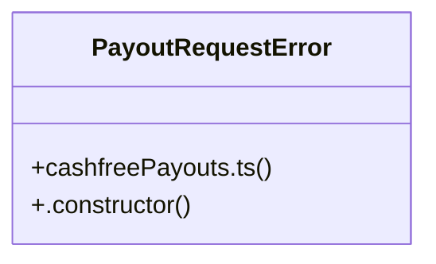

# Analytics & Payouts

> 68 nodes · cohesion 0.05

## Key Concepts

- [PATCH()](file:///C:/Nikunj/src/app/api/orders/%5Bid%5D/route.ts#L38) (33 connections)
- [catch()](file:///C:/Nikunj/src/app/login/whatsapp/page.tsx#L228) (30 connections)
- [set()](file:///C:/Nikunj/src/frontend/components/products/ProductOptions.tsx#L170) (25 connections)
- [sendApproved()](file:///C:/Nikunj/src/backend/lib/refunds.ts#L255) (14 connections)
- [refunds.ts](file:///C:/Nikunj/src/backend/lib/refunds.ts#L1) (12 connections)
- [recordOutcome()](file:///C:/Nikunj/src/backend/lib/refunds.ts#L153) (11 connections)
- [recordOrderPlaced()](file:///C:/Nikunj/src/backend/lib/analytics.ts#L69) (9 connections)
- [cashfreePayouts.ts](file:///C:/Nikunj/src/backend/lib/cashfreePayouts.ts#L1) (9 connections)
- [razorpay.ts](file:///C:/Nikunj/src/backend/lib/razorpay.ts#L1) (9 connections)
- [order-request-auth.test.ts](file:///C:/Nikunj/tests/order-request-auth.test.ts#L1) (8 connections)
- [createPayoutTransfer()](file:///C:/Nikunj/src/backend/lib/cashfreePayouts.ts#L98) (8 connections)
- [getPayoutTransfer()](file:///C:/Nikunj/src/backend/lib/cashfreePayouts.ts#L131) (8 connections)
- [lookupAtGateway()](file:///C:/Nikunj/src/backend/lib/refunds.ts#L131) (8 connections)
- [getClient()](file:///C:/Nikunj/src/backend/lib/razorpay.ts#L26) (7 connections)
- [failApproved()](file:///C:/Nikunj/src/backend/lib/refunds.ts#L226) (7 connections)
- [sendToGateway()](file:///C:/Nikunj/src/backend/lib/refunds.ts#L109) (7 connections)
- [syncProcessing()](file:///C:/Nikunj/src/backend/lib/refunds.ts#L208) (7 connections)
- [analytics.ts](file:///C:/Nikunj/src/backend/lib/analytics.ts#L1) (6 connections)
- [processRefund()](file:///C:/Nikunj/src/backend/lib/refunds.ts#L238) (6 connections)
- [recordDayUpdate()](file:///C:/Nikunj/src/backend/lib/analytics.ts#L22) (5 connections)
- [addRestockPatches()](file:///C:/Nikunj/src/cms/lib/orderOps.ts#L24) (5 connections)
- [verifyPaymentSignature()](file:///C:/Nikunj/src/backend/lib/razorpay.ts#L77) (5 connections)
- [analyticsEnabled()](file:///C:/Nikunj/src/backend/lib/analytics.ts#L16) (4 connections)
- [leadId()](file:///C:/Nikunj/src/backend/lib/analytics.ts#L19) (4 connections)
- [recordLead()](file:///C:/Nikunj/src/backend/lib/analytics.ts#L50) (4 connections)
- *... and 43 more nodes in this community*

## Class Diagram

## Relationships

- [[Community 999]] (4 shared connections)

## Source Files

- [C:\Nikunj\src\app\api\orders\[id]\route.ts](file:///C:/Nikunj/src/app/api/orders/%5Bid%5D/route.ts)
- [C:\Nikunj\src\app\api\payment\webhook\route.ts](file:///C:/Nikunj/src/app/api/payment/webhook/route.ts)
- [C:\Nikunj\src\app\login\whatsapp\page.tsx](file:///C:/Nikunj/src/app/login/whatsapp/page.tsx)
- [C:\Nikunj\src\app\not-found.tsx](file:///C:/Nikunj/src/app/not-found.tsx)
- [C:\Nikunj\src\backend\lib\analytics.ts](file:///C:/Nikunj/src/backend/lib/analytics.ts)
- [C:\Nikunj\src\backend\lib\cashfreePayouts.ts](file:///C:/Nikunj/src/backend/lib/cashfreePayouts.ts)
- [C:\Nikunj\src\backend\lib\razorpay.ts](file:///C:/Nikunj/src/backend/lib/razorpay.ts)
- [C:\Nikunj\src\backend\lib\refunds.ts](file:///C:/Nikunj/src/backend/lib/refunds.ts)
- [C:\Nikunj\src\cms\lib\orderOps.ts](file:///C:/Nikunj/src/cms/lib/orderOps.ts)
- [C:\Nikunj\src\cms\lib\orderStock.ts](file:///C:/Nikunj/src/cms/lib/orderStock.ts)
- [C:\Nikunj\src\cms\tools\BulkProductImport.tsx](file:///C:/Nikunj/src/cms/tools/BulkProductImport.tsx)
- [C:\Nikunj\src\frontend\components\products\ProductOptions.tsx](file:///C:/Nikunj/src/frontend/components/products/ProductOptions.tsx)
- [C:\Nikunj\tests\order-request-auth.test.ts](file:///C:/Nikunj/tests/order-request-auth.test.ts)

## Audit Trail

- EXTRACTED: 201 (57%)
- INFERRED: 154 (43%)
- AMBIGUOUS: 0 (0%)

---

*Part of the graphify knowledge wiki. See [[index]] to navigate.*