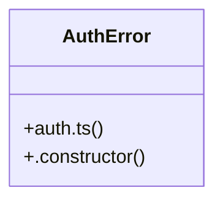

# Auth & Guest Payment

> 148 nodes · cohesion 0.02

## Key Concepts

- [POST()](file:///C:/Nikunj/src/app/api/webhooks/whatsapp/route.ts#L40) (145 connections)
- [GET()](file:///C:/Nikunj/src/app/api/webhooks/whatsapp/route.ts#L28) (55 connections)
- [auth.ts](file:///C:/Nikunj/src/backend/lib/auth.ts#L1) (15 connections)
- [session.ts](file:///C:/Nikunj/src/backend/lib/session.ts#L1) (10 connections)
- [verifyOrderAccess()](file:///C:/Nikunj/src/backend/lib/orderAccess.ts#L18) (9 connections)
- [isIpLimited](file:///C:/Nikunj/src/app/api/payment/guest-verify/send-otp/route.ts#L16) (9 connections)
- [isRateLimited](file:///C:/Nikunj/src/app/api/track-order/route.ts#L10) (9 connections)
- [verifySanityStudioToken()](file:///C:/Nikunj/src/backend/lib/studioAuth.ts#L18) (9 connections)
- [studioAuth.ts](file:///C:/Nikunj/src/backend/lib/studioAuth.ts#L1) (8 connections)
- [route.ts](file:///C:/Nikunj/src/app/api/payment/cashfree/create/route.ts#L1) (7 connections)
- [parseAddress()](file:///C:/Nikunj/src/app/api/account/addresses/route.ts#L23) (7 connections)
- [runtime](file:///C:/Nikunj/src/app/api/refunds/process/route.ts#L7) (7 connections)
- [route.ts](file:///C:/Nikunj/src/app/api/analytics/track/route.ts#L1) (6 connections)
- [route.ts](file:///C:/Nikunj/src/app/api/orders/request/route.ts#L1) (6 connections)
- [route.ts](file:///C:/Nikunj/src/app/api/orders/route.ts#L1) (6 connections)
- [route.ts](file:///C:/Nikunj/src/app/api/webhooks/order-status/route.ts#L1) (6 connections)
- [route.ts](file:///C:/Nikunj/src/app/api/webhooks/whatsapp/route.ts#L1) (6 connections)
- [revalidate.test.ts](file:///C:/Nikunj/tests/revalidate.test.ts#L1) (6 connections)
- [requireAuthHybrid](file:///C:/Nikunj/tests/payment-cashfree-verify.test.ts#L11) (6 connections)
- [dynamic](file:///C:/Nikunj/src/app/api/webhooks/whatsapp/route.ts#L6) (6 connections)
- [publicUser()](file:///C:/Nikunj/src/backend/lib/session.ts#L9) (6 connections)
- [setSessionCookie()](file:///C:/Nikunj/src/backend/lib/session.ts#L38) (6 connections)
- [requireAuth()](file:///C:/Nikunj/src/backend/lib/auth.ts#L72) (5 connections)
- [route.ts](file:///C:/Nikunj/src/app/api/account/addresses/route.ts#L1) (5 connections)
- [route.ts](file:///C:/Nikunj/src/app/api/auth/whatsapp/send-otp/route.ts#L1) (5 connections)
- *... and 123 more nodes in this community*

## Class Diagram

## Relationships

- [[Community 999]] (13 shared connections)

## Source Files

- [C:\Nikunj\src\app\api\account\addresses\route.ts](file:///C:/Nikunj/src/app/api/account/addresses/route.ts)
- [C:\Nikunj\src\app\api\account\profile\route.ts](file:///C:/Nikunj/src/app/api/account/profile/route.ts)
- [C:\Nikunj\src\app\api\analytics\track\route.ts](file:///C:/Nikunj/src/app/api/analytics/track/route.ts)
- [C:\Nikunj\src\app\api\auth\google\callback\route.ts](file:///C:/Nikunj/src/app/api/auth/google/callback/route.ts)
- [C:\Nikunj\src\app\api\auth\google\route.ts](file:///C:/Nikunj/src/app/api/auth/google/route.ts)
- [C:\Nikunj\src\app\api\auth\login\route.ts](file:///C:/Nikunj/src/app/api/auth/login/route.ts)
- [C:\Nikunj\src\app\api\auth\logout\route.ts](file:///C:/Nikunj/src/app/api/auth/logout/route.ts)
- [C:\Nikunj\src\app\api\auth\me\route.ts](file:///C:/Nikunj/src/app/api/auth/me/route.ts)
- [C:\Nikunj\src\app\api\auth\providers\route.ts](file:///C:/Nikunj/src/app/api/auth/providers/route.ts)
- [C:\Nikunj\src\app\api\auth\register\route.ts](file:///C:/Nikunj/src/app/api/auth/register/route.ts)
- [C:\Nikunj\src\app\api\auth\send-otp\route.ts](file:///C:/Nikunj/src/app/api/auth/send-otp/route.ts)
- [C:\Nikunj\src\app\api\auth\verify-otp\route.ts](file:///C:/Nikunj/src/app/api/auth/verify-otp/route.ts)
- [C:\Nikunj\src\app\api\auth\whatsapp\send-otp\route.ts](file:///C:/Nikunj/src/app/api/auth/whatsapp/send-otp/route.ts)
- [C:\Nikunj\src\app\api\auth\whatsapp\verify-otp\route.ts](file:///C:/Nikunj/src/app/api/auth/whatsapp/verify-otp/route.ts)
- [C:\Nikunj\src\app\api\contact\route.ts](file:///C:/Nikunj/src/app/api/contact/route.ts)
- [C:\Nikunj\src\app\api\coupon\validate\route.ts](file:///C:/Nikunj/src/app/api/coupon/validate/route.ts)
- [C:\Nikunj\src\app\api\delivery\assign\route.ts](file:///C:/Nikunj/src/app/api/delivery/assign/route.ts)
- [C:\Nikunj\src\app\api\delivery\resend\route.ts](file:///C:/Nikunj/src/app/api/delivery/resend/route.ts)
- [C:\Nikunj\src\app\api\delivery\verify\route.ts](file:///C:/Nikunj/src/app/api/delivery/verify/route.ts)
- [C:\Nikunj\src\app\api\feedback\route.ts](file:///C:/Nikunj/src/app/api/feedback/route.ts)

## Audit Trail

- EXTRACTED: 451 (68%)
- INFERRED: 214 (32%)
- AMBIGUOUS: 0 (0%)

---

*Part of the graphify knowledge wiki. See [[index]] to navigate.*