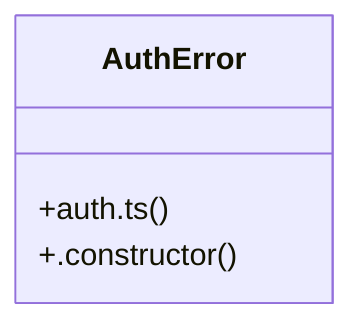

# Community 10

> 66 nodes · cohesion 0.04

## Key Concepts

- [payment-cashfree-verify.test.ts](file:///C:/Nikunj/tests/payment-cashfree-verify.test.ts#L1) (16 connections)
- [auth.ts](file:///C:/Nikunj/src/backend/lib/auth.ts#L1) (15 connections)
- [settleCashfreeOrder()](file:///C:/Nikunj/src/backend/lib/cashfreeSettlement.ts#L37) (10 connections)
- [sanitizePhone()](file:///C:/Nikunj/src/backend/lib/auth.ts#L113) (9 connections)
- [orderNotify.ts](file:///C:/Nikunj/src/backend/lib/orderNotify.ts#L1) (8 connections)
- [whatsappWebhook.test.ts](file:///C:/Nikunj/tests/whatsappWebhook.test.ts#L1) (8 connections)
- [buildNotificationSnapshot()](file:///C:/Nikunj/src/backend/lib/orderNotify.ts#L60) (7 connections)
- [verify()](file:///C:/Nikunj/tests/payment-cashfree-verify.test.ts#L64) (6 connections)
- [requireAuth()](file:///C:/Nikunj/src/backend/lib/auth.ts#L72) (5 connections)
- [post()](file:///C:/Nikunj/tests/whatsappWebhook.test.ts#L15) (5 connections)
- [signToken()](file:///C:/Nikunj/src/backend/lib/auth.ts#L27) (4 connections)
- [verifyToken()](file:///C:/Nikunj/src/backend/lib/auth.ts#L31) (4 connections)
- [cashfreeSettlement.ts](file:///C:/Nikunj/src/backend/lib/cashfreeSettlement.ts#L1) (4 connections)
- [guestPaymentProof.ts](file:///C:/Nikunj/src/backend/lib/guestPaymentProof.ts#L1) (4 connections)
- [orderStatusWebhook.test.ts](file:///C:/Nikunj/tests/orderStatusWebhook.test.ts#L1) (4 connections)
- [upi-reference.test.ts](file:///C:/Nikunj/tests/upi-reference.test.ts#L1) (4 connections)
- [markFailed()](file:///C:/Nikunj/src/backend/lib/cashfreeSettlement.ts#L108) (4 connections)
- [createGuestPaymentProof()](file:///C:/Nikunj/src/backend/lib/guestPaymentProof.ts#L17) (4 connections)
- [hasVerifiedEmail()](file:///C:/Nikunj/src/backend/lib/orderNotify.ts#L40) (4 connections)
- [hasVerifiedPhone()](file:///C:/Nikunj/src/backend/lib/orderNotify.ts#L42) (4 connections)
- [snapshotForOrder()](file:///C:/Nikunj/src/backend/lib/orderNotify.ts#L83) (4 connections)
- [whatsappSnapshot()](file:///C:/Nikunj/src/backend/lib/orderNotify.ts#L50) (4 connections)
- [sign()](file:///C:/Nikunj/tests/whatsappWebhook.test.ts#L12) (4 connections)
- [extractToken()](file:///C:/Nikunj/src/backend/lib/auth.ts#L52) (3 connections)
- [jwtSecret()](file:///C:/Nikunj/src/backend/lib/auth.ts#L16) (3 connections)
- *... and 41 more nodes in this community*

## Class Diagram

## Relationships

- [[Community 999]] (1 shared connections)

## Source Files

- [C:\Nikunj\src\backend\lib\auth.ts](file:///C:/Nikunj/src/backend/lib/auth.ts)
- [C:\Nikunj\src\backend\lib\cashfreeSettlement.ts](file:///C:/Nikunj/src/backend/lib/cashfreeSettlement.ts)
- [C:\Nikunj\src\backend\lib\guestPaymentProof.ts](file:///C:/Nikunj/src/backend/lib/guestPaymentProof.ts)
- [C:\Nikunj\src\backend\lib\orderNotify.ts](file:///C:/Nikunj/src/backend/lib/orderNotify.ts)
- [C:\Nikunj\tests\delivery.test.ts](file:///C:/Nikunj/tests/delivery.test.ts)
- [C:\Nikunj\tests\orderStatusWebhook.test.ts](file:///C:/Nikunj/tests/orderStatusWebhook.test.ts)
- [C:\Nikunj\tests\payment-cashfree-verify.test.ts](file:///C:/Nikunj/tests/payment-cashfree-verify.test.ts)
- [C:\Nikunj\tests\upi-reference.test.ts](file:///C:/Nikunj/tests/upi-reference.test.ts)
- [C:\Nikunj\tests\whatsappWebhook.test.ts](file:///C:/Nikunj/tests/whatsappWebhook.test.ts)

## Audit Trail

- EXTRACTED: 154 (73%)
- INFERRED: 56 (27%)
- AMBIGUOUS: 0 (0%)

---

*Part of the graphify knowledge wiki. See [[index]] to navigate.*