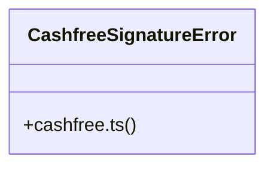

# Community 11

> 40 nodes · cohesion 0.07

## Key Concepts

- [digest()](file:///C:/Nikunj/src/backend/lib/otpHash.ts#L20) (15 connections)
- [cashfree-signature.test.ts](file:///C:/Nikunj/tests/cashfree-signature.test.ts#L1) (14 connections)
- [cashfree.ts](file:///C:/Nikunj/src/backend/lib/cashfree.ts#L1) (11 connections)
- [getClient()](file:///C:/Nikunj/src/backend/lib/cashfree.ts#L22) (9 connections)
- [otpHash.ts](file:///C:/Nikunj/src/backend/lib/otpHash.ts#L1) (7 connections)
- [deliveryOtp()](file:///C:/Nikunj/src/backend/lib/otpHash.ts#L39) (7 connections)
- [otpMatches()](file:///C:/Nikunj/src/backend/lib/otpHash.ts#L28) (5 connections)
- [verifyCashfreeWebhookSignature()](file:///C:/Nikunj/src/backend/lib/cashfree.ts#L131) (4 connections)
- [cashfreeEnvironment()](file:///C:/Nikunj/src/backend/lib/cashfreeConfig.ts#L28) (4 connections)
- [isCashfreeConfigured](file:///C:/Nikunj/tests/payment-cashfree-verify.test.ts#L10) (4 connections)
- [cashfreeConfig.ts](file:///C:/Nikunj/src/backend/lib/cashfreeConfig.ts#L1) (3 connections)
- [createCashfreeOrder()](file:///C:/Nikunj/src/backend/lib/cashfree.ts#L58) (3 connections)
- [createCashfreeRefund()](file:///C:/Nikunj/src/backend/lib/cashfree.ts#L101) (3 connections)
- [fetchCashfreeRefund()](file:///C:/Nikunj/src/backend/lib/cashfree.ts#L116) (3 connections)
- [hashOtp()](file:///C:/Nikunj/src/backend/lib/otpHash.ts#L23) (3 connections)
- [isHashedOtp()](file:///C:/Nikunj/src/backend/lib/otpHash.ts#L18) (3 connections)
- [otpKey()](file:///C:/Nikunj/src/backend/lib/otpHash.ts#L10) (3 connections)
- [cashfreeApiVersion()](file:///C:/Nikunj/src/backend/lib/cashfree.ts#L10) (2 connections)
- [fetchCashfreeOrder()](file:///C:/Nikunj/src/backend/lib/cashfree.ts#L83) (2 connections)
- [fetchCashfreeOrderPayments()](file:///C:/Nikunj/src/backend/lib/cashfree.ts#L90) (2 connections)
- [constructor()](file:///C:/Nikunj/tests/cashfree-signature.test.ts#L14) (2 connections)
- [PGCreateOrder](file:///C:/Nikunj/tests/cashfree-signature.test.ts#L6) (2 connections)
- [sign()](file:///C:/Nikunj/tests/cashfree-signature.test.ts#L21) (2 connections)
- [isCashfreeConfigured()](file:///C:/Nikunj/src/backend/lib/cashfreeConfig.ts#L10) (2 connections)
- [CashfreeSignatureError](file:///C:/Nikunj/src/backend/lib/cashfree.ts#L122) (1 connections)
- *... and 15 more nodes in this community*

## Class Diagram

## Relationships

- No strong cross-community connections detected

## Source Files

- [C:\Nikunj\src\backend\lib\cashfree.ts](file:///C:/Nikunj/src/backend/lib/cashfree.ts)
- [C:\Nikunj\src\backend\lib\cashfreeConfig.ts](file:///C:/Nikunj/src/backend/lib/cashfreeConfig.ts)
- [C:\Nikunj\src\backend\lib\otpHash.ts](file:///C:/Nikunj/src/backend/lib/otpHash.ts)
- [C:\Nikunj\tests\cashfree-signature.test.ts](file:///C:/Nikunj/tests/cashfree-signature.test.ts)
- [C:\Nikunj\tests\payment-cashfree-verify.test.ts](file:///C:/Nikunj/tests/payment-cashfree-verify.test.ts)

## Audit Trail

- EXTRACTED: 97 (74%)
- INFERRED: 34 (26%)
- AMBIGUOUS: 0 (0%)

---

*Part of the graphify knowledge wiki. See [[index]] to navigate.*