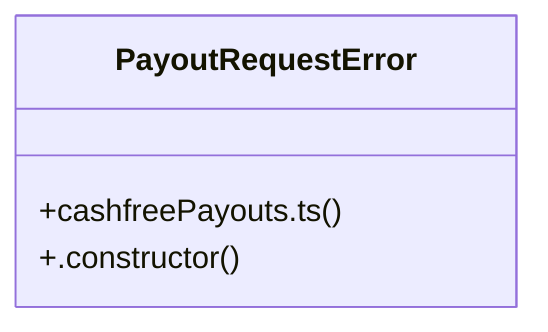

# Community 15

> 32 nodes · cohesion 0.13

## Key Concepts

- [sendApproved()](file:///C:/Nikunj/src/backend/lib/refunds.ts#L255) (14 connections)
- [refunds.ts](file:///C:/Nikunj/src/backend/lib/refunds.ts#L1) (12 connections)
- [cashfreePayouts.ts](file:///C:/Nikunj/src/backend/lib/cashfreePayouts.ts#L1) (9 connections)
- [razorpay.ts](file:///C:/Nikunj/src/backend/lib/razorpay.ts#L1) (9 connections)
- [createPayoutTransfer()](file:///C:/Nikunj/src/backend/lib/cashfreePayouts.ts#L98) (8 connections)
- [getPayoutTransfer()](file:///C:/Nikunj/src/backend/lib/cashfreePayouts.ts#L131) (8 connections)
- [lookupAtGateway()](file:///C:/Nikunj/src/backend/lib/refunds.ts#L131) (8 connections)
- [getClient()](file:///C:/Nikunj/src/backend/lib/razorpay.ts#L26) (7 connections)
- [sendToGateway()](file:///C:/Nikunj/src/backend/lib/refunds.ts#L109) (7 connections)
- [syncProcessing()](file:///C:/Nikunj/src/backend/lib/refunds.ts#L208) (7 connections)
- [processRefund()](file:///C:/Nikunj/src/backend/lib/refunds.ts#L238) (6 connections)
- [verifyPaymentSignature()](file:///C:/Nikunj/src/backend/lib/razorpay.ts#L77) (5 connections)
- [baseUrl()](file:///C:/Nikunj/src/backend/lib/cashfreePayouts.ts#L13) (4 connections)
- [headers()](file:///C:/Nikunj/src/backend/lib/cashfreePayouts.ts#L24) (4 connections)
- [isPayoutsConfigured()](file:///C:/Nikunj/src/backend/lib/cashfreePayouts.ts#L9) (4 connections)
- [signature()](file:///C:/Nikunj/src/backend/lib/cashfreePayouts.ts#L16) (4 connections)
- [toResult()](file:///C:/Nikunj/src/backend/lib/cashfreePayouts.ts#L75) (4 connections)
- [gatewayErrorMessage()](file:///C:/Nikunj/src/backend/lib/refunds.ts#L69) (4 connections)
- [createRazorpayRefund()](file:///C:/Nikunj/src/backend/lib/razorpay.ts#L57) (3 connections)
- [fetchRazorpayOrder()](file:///C:/Nikunj/src/backend/lib/razorpay.ts#L52) (3 connections)
- [fetchRazorpayRefund()](file:///C:/Nikunj/src/backend/lib/razorpay.ts#L66) (3 connections)
- [findRazorpayRefundByReceipt()](file:///C:/Nikunj/src/backend/lib/razorpay.ts#L71) (3 connections)
- [getCredentials()](file:///C:/Nikunj/src/backend/lib/razorpay.ts#L16) (3 connections)
- [mapCashfreeRefund()](file:///C:/Nikunj/src/backend/lib/refunds.ts#L93) (3 connections)
- [mapRazorpayRefund()](file:///C:/Nikunj/src/backend/lib/refunds.ts#L103) (3 connections)
- *... and 7 more nodes in this community*

## Class Diagram

## Relationships

- No strong cross-community connections detected

## Source Files

- [C:\Nikunj\src\backend\lib\cashfreePayouts.ts](file:///C:/Nikunj/src/backend/lib/cashfreePayouts.ts)
- [C:\Nikunj\src\backend\lib\razorpay.ts](file:///C:/Nikunj/src/backend/lib/razorpay.ts)
- [C:\Nikunj\src\backend\lib\refunds.ts](file:///C:/Nikunj/src/backend/lib/refunds.ts)

## Audit Trail

- EXTRACTED: 118 (76%)
- INFERRED: 38 (24%)
- AMBIGUOUS: 0 (0%)

---

*Part of the graphify knowledge wiki. See [[index]] to navigate.*