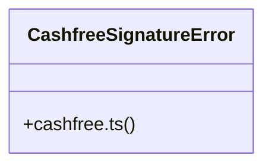

# Community 17

> 30 nodes · cohesion 0.08

## Key Concepts

- [cashfree-signature.test.ts](file:///C:/Nikunj/tests/cashfree-signature.test.ts#L1) (14 connections)
- [cashfree.ts](file:///C:/Nikunj/src/backend/lib/cashfree.ts#L1) (11 connections)
- [getClient()](file:///C:/Nikunj/src/backend/lib/cashfree.ts#L22) (9 connections)
- [cashfreeEnvironment()](file:///C:/Nikunj/src/backend/lib/cashfreeConfig.ts#L28) (4 connections)
- [cashfreeConfig.ts](file:///C:/Nikunj/src/backend/lib/cashfreeConfig.ts#L1) (3 connections)
- [createCashfreeOrder()](file:///C:/Nikunj/src/backend/lib/cashfree.ts#L58) (3 connections)
- [createCashfreeRefund()](file:///C:/Nikunj/src/backend/lib/cashfree.ts#L101) (3 connections)
- [fetchCashfreeRefund()](file:///C:/Nikunj/src/backend/lib/cashfree.ts#L116) (3 connections)
- [cashfreeApiVersion()](file:///C:/Nikunj/src/backend/lib/cashfree.ts#L10) (2 connections)
- [fetchCashfreeOrder()](file:///C:/Nikunj/src/backend/lib/cashfree.ts#L83) (2 connections)
- [fetchCashfreeOrderPayments()](file:///C:/Nikunj/src/backend/lib/cashfree.ts#L90) (2 connections)
- [constructor()](file:///C:/Nikunj/tests/cashfree-signature.test.ts#L14) (2 connections)
- [PGCreateOrder](file:///C:/Nikunj/tests/cashfree-signature.test.ts#L6) (2 connections)
- [sign()](file:///C:/Nikunj/tests/cashfree-signature.test.ts#L21) (2 connections)
- [isCashfreeConfigured()](file:///C:/Nikunj/src/backend/lib/cashfreeConfig.ts#L10) (2 connections)
- [CashfreeSignatureError](file:///C:/Nikunj/src/backend/lib/cashfree.ts#L122) (1 connections)
- [client](file:///C:/Nikunj/src/backend/lib/cashfree.ts#L5) (1 connections)
- [DEFAULT_CASHFREE_API_VERSION](file:///C:/Nikunj/src/backend/lib/cashfree.ts#L7) (1 connections)
- [body](file:///C:/Nikunj/tests/cashfree-signature.test.ts#L42) (1 connections)
- [{ createCashfreeOrder }](file:///C:/Nikunj/tests/cashfree-signature.test.ts#L87) (1 connections)
- [ctorArgs](file:///C:/Nikunj/tests/cashfree-signature.test.ts#L7) (1 connections)
- [good](file:///C:/Nikunj/tests/cashfree-signature.test.ts#L54) (1 connections)
- [reformatted](file:///C:/Nikunj/tests/cashfree-signature.test.ts#L62) (1 connections)
- [[req, requestId, idempotencyKey]](file:///C:/Nikunj/tests/cashfree-signature.test.ts#L97) (1 connections)
- [result](file:///C:/Nikunj/tests/cashfree-signature.test.ts#L47) (1 connections)
- *... and 5 more nodes in this community*

## Class Diagram

## Relationships

- No strong cross-community connections detected

## Source Files

- [C:\Nikunj\src\backend\lib\cashfree.ts](file:///C:/Nikunj/src/backend/lib/cashfree.ts)
- [C:\Nikunj\src\backend\lib\cashfreeConfig.ts](file:///C:/Nikunj/src/backend/lib/cashfreeConfig.ts)
- [C:\Nikunj\tests\cashfree-signature.test.ts](file:///C:/Nikunj/tests/cashfree-signature.test.ts)

## Audit Trail

- EXTRACTED: 67 (85%)
- INFERRED: 12 (15%)
- AMBIGUOUS: 0 (0%)

---

*Part of the graphify knowledge wiki. See [[index]] to navigate.*