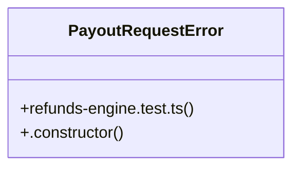

# Community 31

> 13 nodes · cohesion 0.17

## Key Concepts

- [refunds-engine.test.ts](file:///C:/Nikunj/tests/refunds-engine.test.ts#L1) (11 connections)
- [allSets()](file:///C:/Nikunj/tests/refunds-engine.test.ts#L54) (2 connections)
- [lastState()](file:///C:/Nikunj/tests/refunds-engine.test.ts#L55) (2 connections)
- [PayoutRequestError](file:///C:/Nikunj/tests/refunds-engine.test.ts#L41) (2 connections)
- [baseDoc](file:///C:/Nikunj/tests/refunds-engine.test.ts#L57) (1 connections)
- [{ cashfree, razorpay, payouts, whatsapp, orderModel }](file:///C:/Nikunj/tests/refunds-engine.test.ts#L6) (1 connections)
- [committed](file:///C:/Nikunj/tests/refunds-engine.test.ts#L5) (1 connections)
- [log](file:///C:/Nikunj/tests/refunds-engine.test.ts#L160) (1 connections)
- [patchBuilder()](file:///C:/Nikunj/tests/refunds-engine.test.ts#L14) (1 connections)
- [.constructor()](file:///C:/Nikunj/tests/refunds-engine.test.ts#L42) (1 connections)
- [{ processRefund, refundReferenceId }](file:///C:/Nikunj/tests/refunds-engine.test.ts#L52) (1 connections)
- [result](file:///C:/Nikunj/tests/refunds-engine.test.ts#L166) (1 connections)
- [state](file:///C:/Nikunj/tests/refunds-engine.test.ts#L4) (1 connections)

## Class Diagram

## Relationships

- No strong cross-community connections detected

## Source Files

- [C:\Nikunj\tests\refunds-engine.test.ts](file:///C:/Nikunj/tests/refunds-engine.test.ts)

## Audit Trail

- EXTRACTED: 26 (100%)
- INFERRED: 0 (0%)
- AMBIGUOUS: 0 (0%)

---

*Part of the graphify knowledge wiki. See [[index]] to navigate.*