# Knowledge Graph Index

> Auto-generated by graphify. Start here — read community articles for context, then drill into god nodes for detail.

**1839 nodes · 2584 edges · 132 communities**

---

## System Architecture Flowchart

```mermaid
flowchart TD
    C0["Auth & Guest Payment (200 nodes)"]
    C1["Cart & Reviews (97 nodes)"]
    C2["Community 2 (90 nodes)"]
    C3["Community 3 (83 nodes)"]
    C4["Community 4 (81 nodes)"]
    C5["Community 5 (80 nodes)"]
    C6["Analytics & Payouts (74 nodes)"]
    C7["Community 7 (73 nodes)"]
    C8["Community 8 (72 nodes)"]
    C9["Community 9 (71 nodes)"]
    C10["Community 10 (66 nodes)"]
    C11["Community 11 (40 nodes)"]
    C12["Community 12 (38 nodes)"]
    C13["Analytics Tracking (38 nodes)"]
    C14["Community 14 (37 nodes)"]
    C15["Community 15 (32 nodes)"]
    C16["Product Catalog (28 nodes)"]
    C17["Community 17 (26 nodes)"]
    C18["Community 18 (25 nodes)"]
    C19["Community 19 (24 nodes)"]
    C20["Community 20 (22 nodes)"]
    C21["Community 21 (20 nodes)"]
    C22["Community 22 (19 nodes)"]
    C23["Community 23 (18 nodes)"]
    C24["Community 24 (18 nodes)"]
    C25["Community 25 (17 nodes)"]
    C26["Community 26 (15 nodes)"]
    C27["Order OTP (13 nodes)"]
    C28["Community 28 (13 nodes)"]
    C29["Cashfree Webhook (12 nodes)"]
    C30["Community 30 (12 nodes)"]
    C31["Community 31 (10 nodes)"]
    C32["Community 32 (10 nodes)"]
    C33["UI Theme (9 nodes)"]
    C34["Community 34 (9 nodes)"]
    C35["Community 35 (8 nodes)"]
    C36["Community 36 (8 nodes)"]
    C37["Typography Resources (8 nodes)"]
    C38["Community 38 (8 nodes)"]
    C39["Community 39 (8 nodes)"]
    C40["Community 40 (8 nodes)"]
    C41["Community 41 (8 nodes)"]
    C42["Community 42 (8 nodes)"]
    C43["Community 43 (7 nodes)"]
    C44["Community 44 (7 nodes)"]
    C45["Community 45 (7 nodes)"]
    C46["Community 46 (7 nodes)"]
    C47["Product UI Tokens (7 nodes)"]
    C48["Community 48 (7 nodes)"]
    C49["Community 49 (7 nodes)"]
    C50["API Endpoint (7 nodes)"]
    C51["Community 51 (7 nodes)"]
    C52["Community 52 (6 nodes)"]
    C53["Community 53 (6 nodes)"]
    C54["Community 54 (6 nodes)"]
    C55["Community 55 (6 nodes)"]
    C56["Community 56 (6 nodes)"]
    C57["Community 57 (6 nodes)"]
    C58["Delivery Status (6 nodes)"]
    C59["Community 59 (5 nodes)"]
    C60["Community 60 (5 nodes)"]
    C61["Community 61 (5 nodes)"]
    C62["Community 62 (5 nodes)"]
    C63["Persistence Layer (5 nodes)"]
    C64["Community 64 (5 nodes)"]
    C65["Community 65 (5 nodes)"]
    C66["Community 66 (4 nodes)"]
    C67["Community 67 (4 nodes)"]
    C68["Community 68 (4 nodes)"]
    C69["Base Layer (4 nodes)"]
    C70["API Configuration (4 nodes)"]
    C71["Metadata Service (4 nodes)"]
    C72["OTP Service (3 nodes)"]
    C73["unknown (3 nodes)"]
    C74["Community 74 (3 nodes)"]
    C75["Community 75 (3 nodes)"]
    C76["Community 76 (3 nodes)"]
    C77["Button styling (3 nodes)"]
    C78["unknown (3 nodes)"]
    C79["Wishlist Store (3 nodes)"]
    C80["Community 80 (3 nodes)"]
    C81["Linting config (3 nodes)"]
    C82["Community 82 (3 nodes)"]
    C83["Community 83 (2 nodes)"]
    C84["Configuration Management (2 nodes)"]
    C85["Configuration Management (2 nodes)"]
    C86["unknown (2 nodes)"]
    C87["unknown (2 nodes)"]
    C88["unknown (2 nodes)"]
    C89["unknown (2 nodes)"]
    C90["unknown (2 nodes)"]
    C91["Product Catalog (2 nodes)"]
    C92["Community 92 (2 nodes)"]
    C93["Community 93 (2 nodes)"]
    C94["Community 94 (2 nodes)"]
    C95["Fragrance Catalog (2 nodes)"]
    C96["Community 96 (2 nodes)"]
    C97["Database Schema (2 nodes)"]
    C98["Community 98 (2 nodes)"]
    C99["Community 99 (2 nodes)"]
    C100["Community 100 (2 nodes)"]
    C101["unknown (2 nodes)"]
    C102["Community 102 (2 nodes)"]
    C103["unknown (2 nodes)"]
    C104["Community 104 (2 nodes)"]
    C105["Community 105 (2 nodes)"]
    C106["Community 106 (2 nodes)"]
    C107["unknown (2 nodes)"]
    C108["Sizing Domain (2 nodes)"]
    C109["unknown (2 nodes)"]
    C110["unknown (2 nodes)"]
    C111["unknown (2 nodes)"]
    C112["unknown (2 nodes)"]
    C113["Community 113 (2 nodes)"]
    C114["Community 114 (2 nodes)"]
    C115["Community 115 (2 nodes)"]
    C116["Product Variants (2 nodes)"]
    C117["Resource Management (2 nodes)"]
    C118["unknown (2 nodes)"]
    C119["unknown (2 nodes)"]
    C120["unknown (1 nodes)"]
    C121["unknown (1 nodes)"]
    C122["unknown (1 nodes)"]
    C123["unknown (1 nodes)"]
    C124["unknown (1 nodes)"]
    C125["unknown (1 nodes)"]
    C126["unknown (1 nodes)"]
    C127["Identity Management (1 nodes)"]
    C128["Order Management (1 nodes)"]
    C129["One-Time Password (1 nodes)"]
    C130["Order Management (1 nodes)"]
    C131["One-Time Password (1 nodes)"]
    C0 -->|16 edges| C130
    C0 -->|15 edges| C10
    C9 -->|14 edges| C0
    C0 -->|14 edges| C8
    C10 -->|14 edges| C0
    C0 -->|13 edges| C4
    C0 -->|12 edges| C1
    C0 -->|12 edges| C11
    C0 -->|11 edges| C15
    C0 -->|9 edges| C5
    C5 -->|8 edges| C0
    C4 -->|8 edges| C0
    C0 -->|8 edges| C2
    C15 -->|7 edges| C0
    C0 -->|6 edges| C129
    C1 -->|6 edges| C8
    C3 -->|5 edges| C4
    C3 -->|5 edges| C0
    C0 -->|5 edges| C9
    C1 -->|5 edges| C0
    C0 -->|4 edges| C14
    C2 -->|4 edges| C0
    C11 -->|4 edges| C15
    C11 -->|4 edges| C0
    C52 -->|4 edges| C0
    C15 -->|4 edges| C8
    C14 -->|4 edges| C0
    C9 -->|3 edges| C6
    C3 -->|3 edges| C7
    C0 -->|3 edges| C6
    C0 -->|3 edges| C38
    C0 -->|3 edges| C7
    C14 -->|3 edges| C8
    C8 -->|3 edges| C0
    C5 -->|3 edges| C7
    C0 -->|2 edges| C53
    C0 -->|2 edges| C23
    C0 -->|2 edges| C22
    C0 -->|2 edges| C131
    C9 -->|2 edges| C3
    C9 -->|2 edges| C130
    C7 -->|2 edges| C5
    C11 -->|2 edges| C2
    C15 -->|2 edges| C2
    C15 -->|2 edges| C4
    C53 -->|2 edges| C129
    C8 -->|2 edges| C7
    C5 -->|1 edges| C2
    C3 -->|1 edges| C5
    C0 -->|1 edges| C17
    C0 -->|1 edges| C26
    C0 -->|1 edges| C51
    C0 -->|1 edges| C29
    C4 -->|1 edges| C3
    C4 -->|1 edges| C9
    C4 -->|1 edges| C7
    C4 -->|1 edges| C5
    C18 -->|1 edges| C0
    C18 -->|1 edges| C4
    C0 -->|1 edges| C3
    C0 -->|1 edges| C16
    C9 -->|1 edges| C5
    C10 -->|1 edges| C9
    C10 -->|1 edges| C2
    C10 -->|1 edges| C130
    C11 -->|1 edges| C10
    C1 -->|1 edges| C5
    C1 -->|1 edges| C4
    C14 -->|1 edges| C5
    C6 -->|1 edges| C7
    C43 -->|1 edges| C0
    C8 -->|1 edges| C1
    C14 -->|1 edges| C6
    C8 -->|1 edges| C2
    C14 -->|1 edges| C130
    C14 -->|1 edges| C129
    C0 -->|1 edges| C25
    C2 -->|1 edges| C6
    C1 -->|1 edges| C2
    C8 -->|1 edges| C5
    C2 -->|1 edges| C5
    C8 -->|1 edges| C4
    C29 -->|1 edges| C2
    C29 -->|1 edges| C0
    C5 -->|1 edges| C11
    C0 -->|1 edges| C33
    C20 -->|1 edges| C7
    C20 -->|1 edges| C6
    C21 -->|1 edges| C0
    C21 -->|1 edges| C1
    C21 -->|1 edges| C10
    C23 -->|1 edges| C0
    C10 -->|1 edges| C11
    C10 -->|1 edges| C4
    C4 -->|1 edges| C19
    C42 -->|1 edges| C0
```



## Database Schema (ERD)

```mermaid
erDiagram
    User {
        string fullName
        string phone
        string line1
        string city
        string state
        string pincode
        Types addresses
        string wishlist
        Date createdAt
        Date updatedAt
        String line2
        String landmark
        Boolean isDefault
        String name
        true trim
        String email
        true lowercase
        String passwordHash
        false select
        String googleId
        String clerkUserId
        String avatar
        Boolean emailVerified
        Date whatsappLoginAt
        String resetTokenHash
        Date resetTokenExpires
        String role
        true timestamps
        uniqueness indexes
        Model User
        Promise indexesReady
    }
    Order {
        string orderId
        string productId
        string name
        string image
        number price
        number quantity
        string fullName
        string phone
        string line1
        string city
        string state
        string pincode
        number subtotal
        number deliveryCharge
        number discount
        number total
        string method
        Date capturedAt
        string key
        string channel
        Date at
        secret off
        Date createdAt
        Date updatedAt
        1 min
        String selectedSize
        String selectedColor
        String line2
        String landmark
        ObjectId userId
        String guestPhone
        ShippingAddressSchema shippingAddress
        String couponCode
        true uppercase
        String paymentMethod
        String paymentStatus
        String razorpayOrderId
        String razorpayPaymentId
        String paymentGateway
        String cashfreeOrderId
        String cashfreePaymentSessionId
        String cashfreePaymentId
        String upiReference
        32 maxlength
        Date upiReferenceAt
        String status
        String notes
        Boolean stockHeld
        String email
        true lowercase
        String reason
        false _id
        String token
        String partnerName
        Date assignedAt
        Date otpSentAt
        String otpMessageId
        String otpStatus
        Number attempts
        Date verifiedAt
        true timestamps
        true sparse
        Model Order
    }
    Otp {
        string phone
        string otp
        Date expiresAt
        number attempts
        Date createdAt
        hashOtp set
        String channel
        String purpose
        String orderId
        true timestamps
        0 expireAfterSeconds
        Model Otp
    }
```

## Communities
(sorted by size, largest first)

- [[Auth & Guest Payment]] — 200 nodes
- [[Cart & Reviews]] — 97 nodes
- [[Community 2]] — 90 nodes
- [[Community 3]] — 83 nodes
- [[Community 4]] — 81 nodes
- [[Community 5]] — 80 nodes
- [[Analytics & Payouts]] — 74 nodes
- [[Community 7]] — 73 nodes
- [[Community 8]] — 72 nodes
- [[Community 9]] — 71 nodes
- [[Community 10]] — 66 nodes
- [[Community 11]] — 40 nodes
- [[Community 12]] — 38 nodes
- [[Analytics Tracking]] — 38 nodes
- [[Community 14]] — 37 nodes
- [[Community 15]] — 32 nodes
- [[Product Catalog]] — 28 nodes
- [[Community 17]] — 26 nodes
- [[Community 18]] — 25 nodes
- [[Community 19]] — 24 nodes
- [[Community 20]] — 22 nodes
- [[Community 21]] — 20 nodes
- [[Community 22]] — 19 nodes
- [[Community 23]] — 18 nodes
- [[Community 24]] — 18 nodes
- [[Community 25]] — 17 nodes
- [[Community 26]] — 15 nodes
- [[Order OTP]] — 13 nodes
- [[Community 28]] — 13 nodes
- [[Cashfree Webhook]] — 12 nodes
- [[Community 30]] — 12 nodes
- [[Community 31]] — 10 nodes
- [[Community 32]] — 10 nodes
- [[UI Theme]] — 9 nodes
- [[Community 34]] — 9 nodes
- [[Community 35]] — 8 nodes
- [[Community 36]] — 8 nodes
- [[Typography Resources]] — 8 nodes
- [[Community 38]] — 8 nodes
- [[Community 39]] — 8 nodes
- [[Community 40]] — 8 nodes
- [[Community 41]] — 8 nodes
- [[Community 42]] — 8 nodes
- [[Community 43]] — 7 nodes
- [[Community 44]] — 7 nodes
- [[Community 45]] — 7 nodes
- [[Community 46]] — 7 nodes
- [[Product UI Tokens]] — 7 nodes
- [[Community 48]] — 7 nodes
- [[Community 49]] — 7 nodes
- [[API Endpoint]] — 7 nodes
- [[Community 51]] — 7 nodes
- [[Community 52]] — 6 nodes
- [[Community 53]] — 6 nodes
- [[Community 54]] — 6 nodes
- [[Community 55]] — 6 nodes
- [[Community 56]] — 6 nodes
- [[Community 57]] — 6 nodes
- [[Delivery Status]] — 6 nodes
- [[Community 59]] — 5 nodes
- [[Community 60]] — 5 nodes
- [[Community 61]] — 5 nodes
- [[Community 62]] — 5 nodes
- [[Persistence Layer]] — 5 nodes
- [[Community 64]] — 5 nodes
- [[Community 65]] — 5 nodes
- [[Community 66]] — 4 nodes
- [[Community 67]] — 4 nodes
- [[Community 68]] — 4 nodes
- [[Base Layer]] — 4 nodes
- [[API Configuration]] — 4 nodes
- [[Metadata Service]] — 4 nodes
- [[OTP Service]] — 3 nodes
- [[unknown]] — 3 nodes
- [[Community 74]] — 3 nodes
- [[Community 75]] — 3 nodes
- [[Community 76]] — 3 nodes
- [[Button styling]] — 3 nodes
- [[unknown]] — 3 nodes
- [[Wishlist Store]] — 3 nodes
- [[Community 80]] — 3 nodes
- [[Linting config]] — 3 nodes
- [[Community 82]] — 3 nodes
- [[Community 83]] — 2 nodes
- [[Configuration Management]] — 2 nodes
- [[Configuration Management]] — 2 nodes
- [[unknown]] — 2 nodes
- [[unknown]] — 2 nodes
- [[unknown]] — 2 nodes
- [[unknown]] — 2 nodes
- [[unknown]] — 2 nodes
- [[Product Catalog]] — 2 nodes
- [[Community 92]] — 2 nodes
- [[Community 93]] — 2 nodes
- [[Community 94]] — 2 nodes
- [[Fragrance Catalog]] — 2 nodes
- [[Community 96]] — 2 nodes
- [[Database Schema]] — 2 nodes
- [[Community 98]] — 2 nodes
- [[Community 99]] — 2 nodes
- [[Community 100]] — 2 nodes
- [[unknown]] — 2 nodes
- [[Community 102]] — 2 nodes
- [[unknown]] — 2 nodes
- [[Community 104]] — 2 nodes
- [[Community 105]] — 2 nodes
- [[Community 106]] — 2 nodes
- [[unknown]] — 2 nodes
- [[Sizing Domain]] — 2 nodes
- [[unknown]] — 2 nodes
- [[unknown]] — 2 nodes
- [[unknown]] — 2 nodes
- [[unknown]] — 2 nodes
- [[Community 113]] — 2 nodes
- [[Community 114]] — 2 nodes
- [[Community 115]] — 2 nodes
- [[Product Variants]] — 2 nodes
- [[Resource Management]] — 2 nodes
- [[unknown]] — 2 nodes
- [[unknown]] — 2 nodes
- [[unknown]] — 1 nodes
- [[unknown]] — 1 nodes
- [[unknown]] — 1 nodes
- [[unknown]] — 1 nodes
- [[unknown]] — 1 nodes
- [[unknown]] — 1 nodes
- [[unknown]] — 1 nodes
- [[Identity Management]] — 1 nodes
- [[Order Management]] — 1 nodes
- [[One-Time Password]] — 1 nodes
- [[Order Management]] — 1 nodes
- [[One-Time Password]] — 1 nodes

## God Nodes
(most connected concepts — the load-bearing abstractions)

- [[POST()]] — 142 connections
- [[GET()]] — 53 connections
- [[error]] — 45 connections
- [[PATCH()]] — 31 connections
- [[json]] — 29 connections
- [[catch()]] — 28 connections
- [[set()]] — 25 connections
- [[Boolean()]] — 24 connections
- [[push]] — 22 connections
- [[from]] — 18 connections

---

*Generated by [graphify](https://github.com/safishamsi/graphify)*